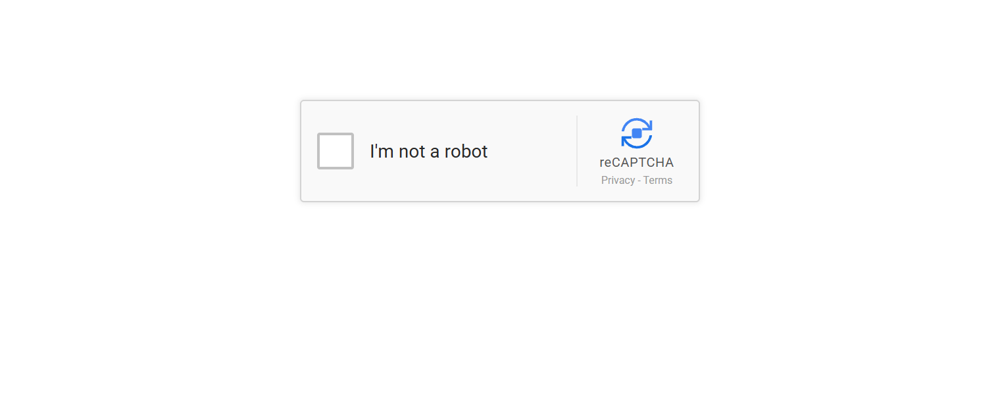
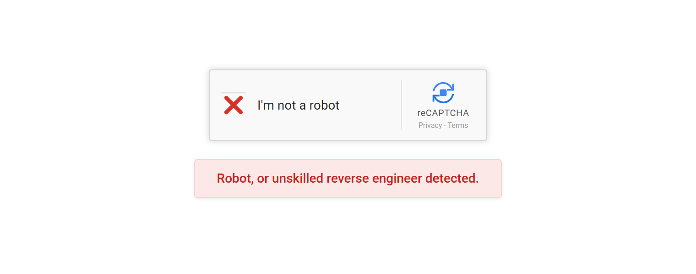
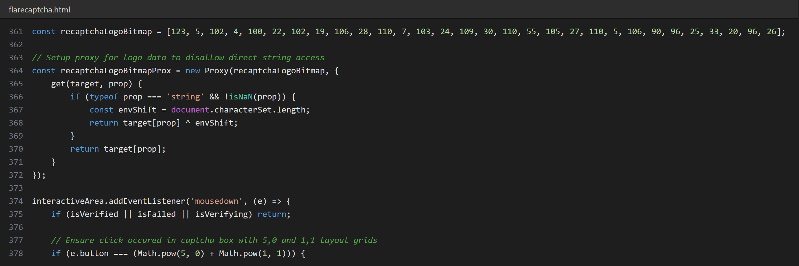
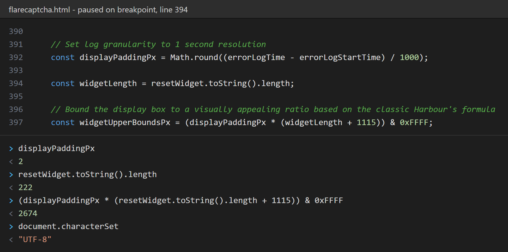
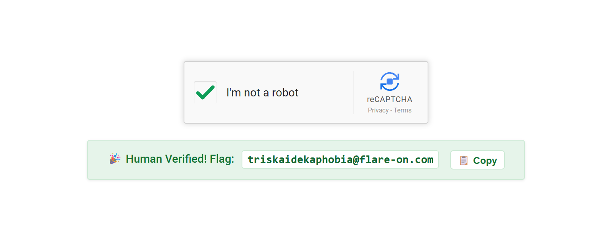
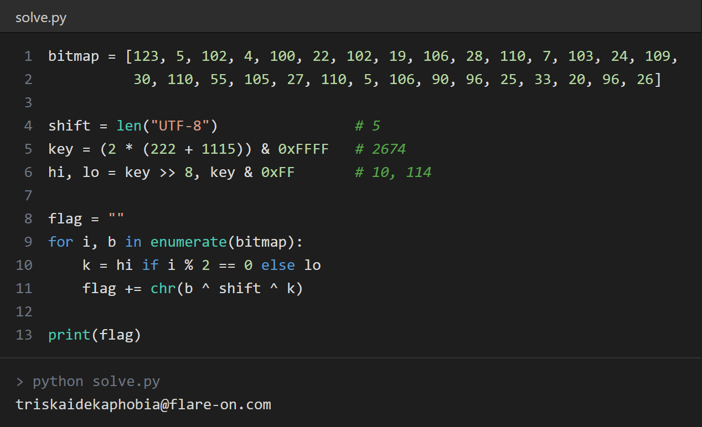

# Flare-On 13 - Challenge 1: flarecaptcha

First challenge of the year, and like most Flare-On openers it is more of a warm-up than anything else. We get a 7z with a single HTML file, `flarecaptcha.html`, which pretends to be a Google reCAPTCHA. Below is how I went through it.

## 1. Opening the page

After extracting the archive I just opened the HTML in the browser to see what it does. It's the usual "I'm not a robot" checkbox, and it looks pretty close to the real one.

<!-- SCREENSHOT: initial page -->


## 2. Clicking it normally

Naturally the first thing I did was click the checkbox. It spins for about a second and then shows a red cross with the message "Robot, or unskilled reverse engineer detected." After that it resets. I tried it a few more times, same result, so clicking around was not going to get me anywhere.

<!-- SCREENSHOT: red cross after left click -->


## 3. Looking at the source

Since it's just an HTML file, I opened it in VS Code. Most of the file is CSS for making the widget look real. The interesting part is the `<script>` block at the end. There were three things worth looking at:

- a hardcoded array called `recaptchaLogoBitmap`
- a `Proxy` wrapped around that array
- the `mousedown` handler on the checkbox

<!-- SCREENSHOT: script block in editor -->


## 4. Which mouse button?

The mousedown handler has this check:

```js
// Ensure click occured in captcha box with 5,0 and 1,1 layout grids
if (e.button === (Math.pow(5, 0) + Math.pow(1, 1))) {
    ...
}
else if (e.button === 0) {
    ...  // spinner, then triggerFailure() after 1s
}
```

The comment is just noise. `Math.pow(5, 0) + Math.pow(1, 1)` is `1 + 1 = 2`, and `e.button == 2` means the right mouse button (0 is left, 1 is middle). So the left click path always ends in `triggerFailure()`, and only a right click can succeed. They also block the context menu with `oncontextmenu="return false;"` so the right click doesn't open the browser menu.

## 5. The 2 second hold

The success code is inside a `setTimeout(..., 2000)`. But there are two listeners that cancel it:

```js
window.addEventListener('mouseup', (e) => {
    if (e.button === 2) cancelHold();
});

interactiveArea.addEventListener('mouseleave', () => {
    cancelHold();
});
```

So you can't just right click. You have to press and hold the right button for 2 seconds and keep the mouse on the box. If you let go early or move out, it fails.

At this point I already knew how to get the flag from the UI, but I wanted to understand how the flag was generated, mostly because it was not stored in plain text anywhere.

## 6. How the flag is built

### The Proxy

```js
const recaptchaLogoBitmap = [123, 5, 102, 4, 100, 22, 102, 19, 106, 28, 110, 7,
                             103, 24, 109, 30, 110, 55, 105, 27, 110, 5, 106, 90,
                             96, 25, 33, 20, 96, 26];

const recaptchaLogoBitmapProx = new Proxy(recaptchaLogoBitmap, {
    get(target, prop) {
        if (typeof prop === 'string' && !isNaN(prop)) {
            const envShift = document.characterSet.length;
            return target[prop] ^ envShift;
        }
        return target[prop];
    }
});
```

Whenever an element is read through the proxy, it gets XORed with `document.characterSet.length`. The page has `<meta charset="UTF-8">`, so `characterSet` is `"UTF-8"`, which is 5 characters. So every byte is first XORed with 5.

### The second key

When the timer fires, this runs:

```js
const displayPaddingPx    = Math.round((errorLogTime - errorLogStartTime) / 1000);
const widgetLength        = resetWidget.toString().length;
const widgetUpperBoundsPx = (displayPaddingPx * (widgetLength + 1115)) & 0xFFFF;
const wupperLeft          = (widgetUpperBoundsPx >> 8) & 0xFF;
const wupperRight         = widgetUpperBoundsPx & 0xFF;
```

Going through it:

- `displayPaddingPx` is the elapsed time in seconds. The timer is 2000 ms, so this rounds to 2.
- `widgetLength` is the length of the `resetWidget` function's source code. `toString()` on a function gives back its exact source, whitespace included. I checked it in the console and it comes out to 222.
- `widgetUpperBoundsPx = 2 * (222 + 1115) = 2674`, which is `0x0A72`.
- `wupperLeft` is the high byte, `0x0A` = 10.
- `wupperRight` is the low byte, `0x72` = 114.

One thing I liked here is the `toString()` trick. If you try to beautify or modify the `resetWidget` function, the length changes and you get garbage instead of the flag. Also, if `displayPaddingPx` were 1, the value would be 1337. I'm not sure if that's on purpose, but it made me smile.

<!-- SCREENSHOT: DevTools console with breakpoint inside setTimeout, showing resetWidget.toString().length -->


### Decoding

```js
const displaySurfaceMap = recaptchaLogoBitmapProx
    .map((b, i) => String.fromCharCode(b ^ (i % 2 === 0 ? wupperLeft : wupperRight)))
    .join('');
```

So in the end each character is:

```
flag[i] = bitmap[i] ^ 5 ^ (10 if i is even else 114)
```

## 7. Getting the flag

The easy way is to open the page, hold the right mouse button on the checkbox for 2 seconds and the flag shows up.

<!-- SCREENSHOT: green tick with the flag -->


I also wrote a small Python script to decode it offline, just to confirm my understanding:

```python
bitmap = [123, 5, 102, 4, 100, 22, 102, 19, 106, 28, 110, 7, 103, 24, 109,
          30, 110, 55, 105, 27, 110, 5, 106, 90, 96, 25, 33, 20, 96, 26]

shift = len("UTF-8")                # 5
key = (2 * (222 + 1115)) & 0xFFFF   # 2674
hi, lo = key >> 8, key & 0xFF       # 10, 114

flag = ""
for i, b in enumerate(bitmap):
    k = hi if i % 2 == 0 else lo
    flag += chr(b ^ shift ^ k)

print(flag)
```

```
triskaidekaphobia@flare-on.com
```

<!-- SCREENSHOT: output of the python script -->


## Notes

Triskaidekaphobia is the fear of the number 13, which fits since this is Flare-On 13.

Overall a simple challenge. The main things to notice were the obfuscated `e.button` check (right click instead of left), the hold timer, and that the key depends on the page itself, through `document.characterSet` and the function source length. Reading the source directly was much faster than trying to guess the interaction.
