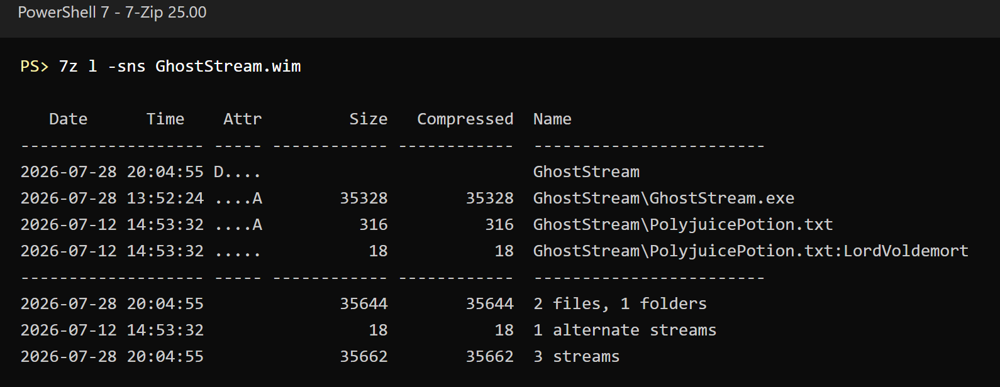
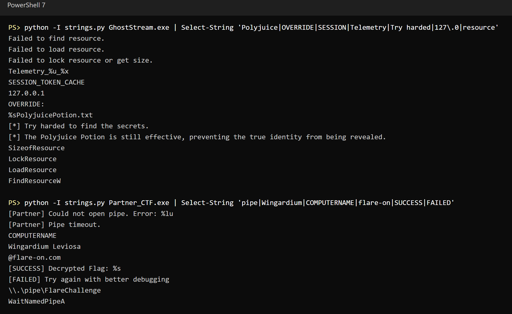
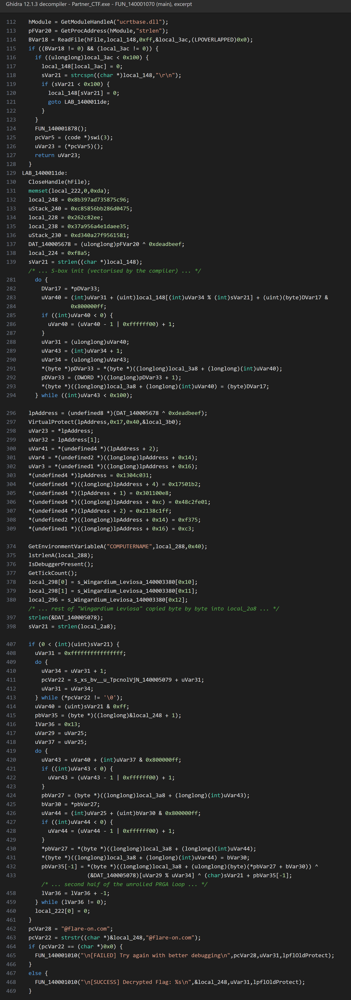
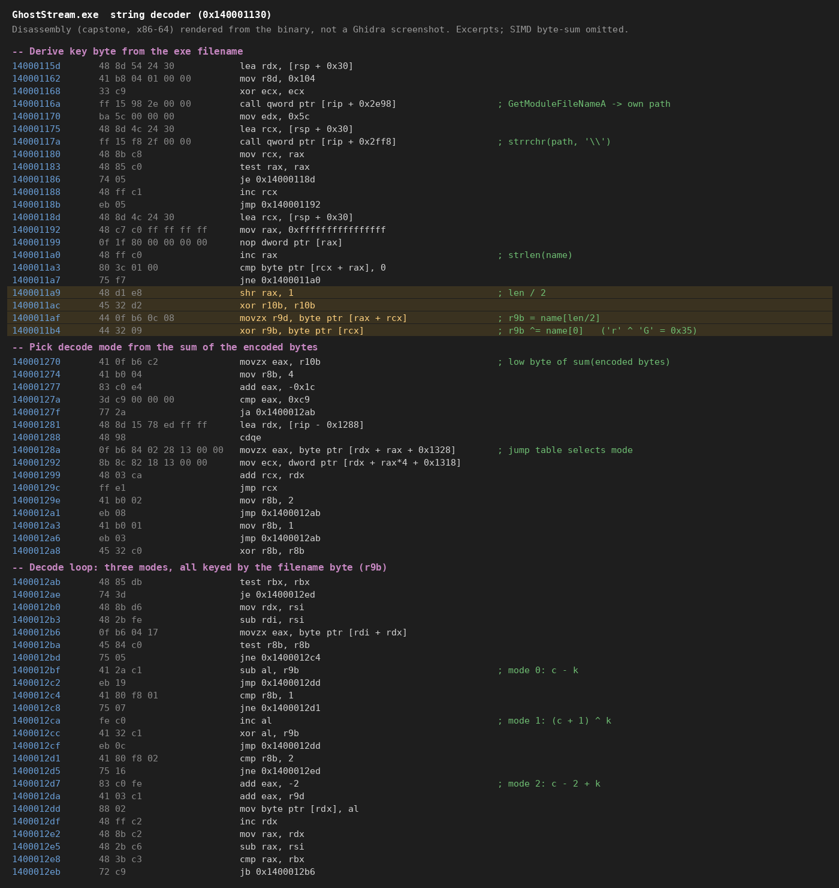
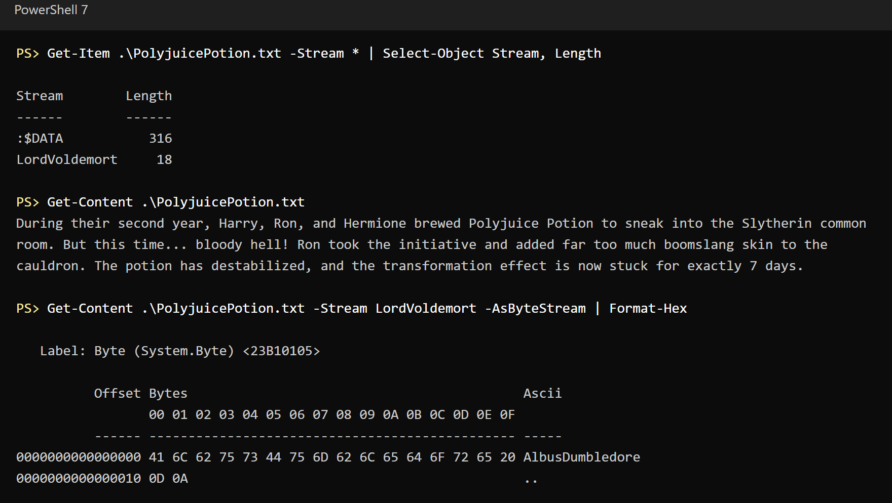
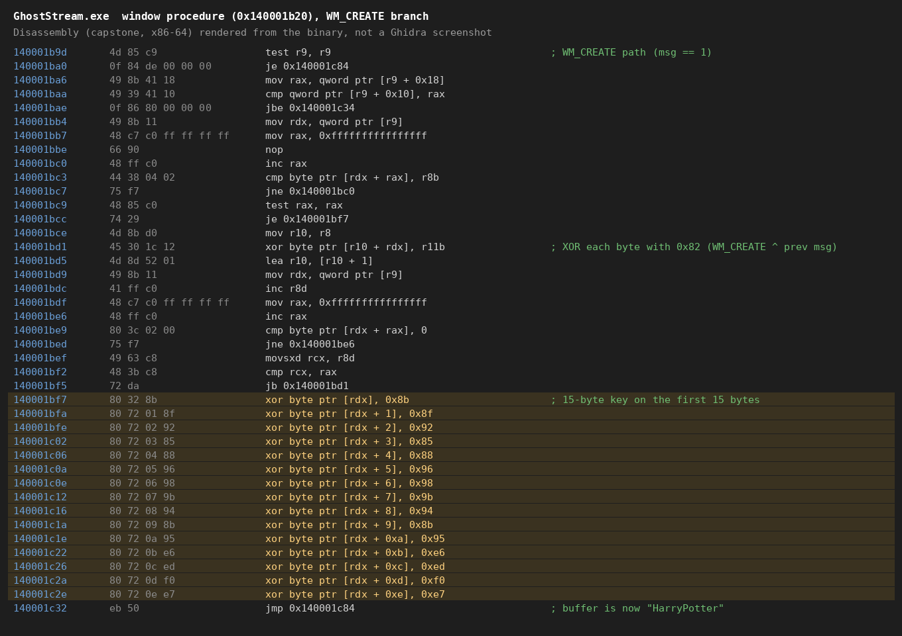

# Flare-On 13 - Challenge 2: GhostStream

This one took me a lot longer than the first challenge. The archive gives a `GhostStream.wim` file, and the challenge text says the file "refuses to talk to the naked eye" and that you might need a debugger to "force a confession". Both hints turned out to be very literal.

## 1. Extracting the files

A `.wim` is a Windows Imaging archive, and 7-Zip opens it fine. Inside there are two files:

- `GhostStream.exe`
- `PolyjuicePotion.txt`

When you run it, `GhostStream.exe` also drops a second binary from its resource section, which I saved as `Partner_CTF.exe`.

One thing I only realised later: WIM archives keep NTFS alternate data streams. That matters a lot for this challenge. A normal `7z l` only shows the two files, but with `-sns` 7-Zip also lists the hidden stream:



## 2. Strings

I started with strings on both binaries.

`GhostStream.exe` had things like `%sPolyjuicePotion.txt`, a named pipe, an `OVERRIDE:` command on a 127.0.0.1 socket, `SESSION_TOKEN_CACHE`, `Telemetry_%u_%x`, and messages like "Try harded to find the secrets." (the typo is in the binary). Most of the API names were missing, so the important strings were clearly built on the stack and decoded at runtime.

`Partner_CTF.exe` was more useful: `\\.\pipe\FlareChallenge`, `Wingardium Leviosa`, `COMPUTERNAME`, `@flare-on.com` and a `[SUCCESS] Decrypted Flag` message. So the picture was: Partner decrypts the flag, using a key that GhostStream sends it over the named pipe.



At this point I tried the obvious things. I ran it, played with the `OVERRIDE:` socket, and used the visible text in `PolyjuicePotion.txt` as the key. Nothing gave me the flag, so I had to actually reverse both binaries.

## 3. Reversing Partner_CTF.exe

I started with Partner because it's smaller and it's the one that prints the flag. I had Claude.ai help me go through the decompiled main function. It does the following:

1. Reads the key from the named pipe and strips the `\r\n`.
2. Runs the RC4 key schedule on that key.
3. Overwrites `ucrtbase!strlen` in memory with a small shellcode. The shellcode decodes an obfuscated global into the string `Piertotum Locomotor`.
4. Decrypts a 38-byte ciphertext with a modified RC4 PRGA. It uses a stride of `strlen("Wingardium Leviosa")` = 18, XORs with `Piertotum Locomotor`, and adds the stride to each ciphertext byte.
5. Checks whether the result ends with `@flare-on.com`.

The `strlen` hook is a sneaky touch. Anything that calls `strlen` after the patch goes through the shellcode instead of the real function.

The 38-byte ciphertext is built on the stack in main from `mov dword ptr [rsp+0x40..0x60]` immediates plus a final `mov word ptr [rsp+0x64], 0xf8a5` (`0x140001211` to `0x140001266`), so it doesn't show up as a blob in the data section.

So the decryption itself was fine. Everything depended on what GhostStream sends through the pipe.

This is the relevant part of main in Ghidra. The compiler vectorised the S-box init into a long mess, so I cut that out:



## 4. Reversing GhostStream.exe

This binary has a lot of noise, so I took it piece by piece, again with Claude.ai helping me read the decompiled code.

**String decoder.** The key for the stack strings comes from the exe's own filename: `name[len/2] ^ name[0]`. For `GhostStream.exe` that is `'r' ^ 'G'` = `0x35`. If you rename the binary, every string decodes to garbage, so keep the original name. Once decoded, the strings included `CreateNamedPipeA`, `NtSetInformationThread` (anti-debug), `GetProcessTimes` and the most important one, `%sPolyjuicePotion.txt:LordVoldemort`.

**Hidden stream.** A worker thread switches the input path from the normal file to the alternate data stream `:LordVoldemort`. It only does this when a global flag is 1, and nothing in the binary ever sets that flag. That's the "force a confession" part: you set it yourself in a debugger.

**7-day check.** Another global holds the number of minutes since the process started, which it gets from `GetProcessTimes`. The window procedure only transforms the data if that value is greater than `len("GhostStream.exe") * 671 + 15` = `15 * 671 + 15` = 10080. 10080 minutes is exactly 7 days, which matches the "stuck for 7 days" story in the challenge.

**Transform.** On `WM_CREATE`, each byte is XORed with `WM_CREATE ^ previous message`. When a window is created, Windows sends `WM_NCCALCSIZE` (0x83) just before `WM_CREATE` (0x01), so the value is `0x01 ^ 0x83` = `0x82`. After that, the first 15 bytes are XORed with a hardcoded key.

The key isn't stored as data, so searching the file for it finds nothing. Each byte is the immediate of its own instruction, starting at `0x140001bf7`:

```
0x140001bf7   80 32 8b      xor byte ptr [rdx], 0x8b
0x140001bfa   80 72 01 8f   xor byte ptr [rdx+1], 0x8f
0x140001bfe   80 72 02 92   xor byte ptr [rdx+2], 0x92
...
0x140001c2e   80 72 0e e7   xor byte ptr [rdx+0xe], 0xe7
```

That gives `8b 8f 92 85 88 96 98 9b 94 8b 95 e6 ed f0 e7`. The same 15 XORs show up a second time at `0x140001c38`, on the path that writes `SESSION_TOKEN_CACHE`.

**Decoys.** The `OVERRIDE:` socket input gets overwritten by the file read anyway, and `SESSION_TOKEN_CACHE` is only set on the failure path. I spent some time on both before noticing that.



## 5. Reading the hidden stream

The visible content of `PolyjuicePotion.txt` is just the story text (the potion "is now stuck for exactly 7 days"). I tried using it, and later `Piertotum Locomotor`, as input, but nothing gave a valid key under any transform, so I needed the ADS.

`Get-Item -Stream *` showed a `LordVoldemort` stream of 18 bytes. My first try, `Format-Hex -Stream`, failed because my PowerShell version doesn't support that parameter. Piping `Get-Content -AsByteStream` into `Format-Hex` worked:

```powershell
Get-Item .\PolyjuicePotion.txt -Stream *
Get-Content .\PolyjuicePotion.txt -Stream LordVoldemort -AsByteStream | Format-Hex
```



The stream contains `AlbusDumbledore \r\n`. It starts with `A`, which also explains the "Polyjuice Potion is still effective" message you get when the 7-day check isn't passed. The untransformed data still looks like Dumbledore.

## 6. Getting the key

Applying the window procedure transform to `AlbusDumbledore \r\n` (XOR with `0x82`, then the 15-byte key) gives:

```
HarryPotter
```

That's the key GhostStream sends through the pipe. The last four key bytes (`e6 ed f0 e7`) are just `"dore" ^ 0x82`, so they zero out the tail and the string ends cleanly after `HarryPotter`.



My first decryption attempt failed. I assumed the PRGA stride came from the patched `strlen`, which would give 0x13 (the length of `Piertotum Locomotor`). It actually uses 18, the real length of `Wingardium Leviosa`. With that fixed, Partner's routine decrypts the flag.

Here's the offline script I ended up with. It does both halves: the GhostStream transform to get the pipe key, then Partner's RC4 variant on the ciphertext. It's also in this folder as [solve.py](solve.py).

```python
ads = b"AlbusDumbledore \r\n"   # PolyjuicePotion.txt:LordVoldemort
xor_key = bytes.fromhex("8b8f92858896989b948b95e6edf0e7")
ct = bytes.fromhex("965c8735d77a398b75046d28bb5658c8"
                   "35eedae1a456a937811556f9270a340d"
                   "ee822c26a5f8")
k2 = b"Piertotum Locomotor"
stride = len(b"Wingardium Leviosa")  # 18

# GhostStream WM_CREATE transform: XOR 0x82, then first 15 bytes with xor_key
buf = bytearray(b ^ 0x82 for b in ads)
for i in range(15):
    buf[i] ^= xor_key[i]
key = bytes(buf).split(b"\r")[0].split(b"\n")[0]
print("Pipe key:", key)

# Partner_CTF: RC4 KSA, then modified PRGA
S = list(range(256))
j = 0
for i in range(256):
    j = (j + S[i] + key[i % len(key)]) & 0xff
    S[i], S[j] = S[j], S[i]

i = j = 0
out = bytearray()
for n, c in enumerate(ct):
    i = (i + stride) & 0xff
    j = (j + S[i]) & 0xff
    S[i], S[j] = S[j], S[i]
    out.append(S[(S[i] + S[j]) & 0xff] ^ k2[n % len(k2)] ^ ((c + stride) & 0xff))
print("Flag:", out.decode())
```

## 7. Doing it live in a debugger

You can also get the flag by running it, without reimplementing anything. Before `CreateWindowExA` is reached, patch two globals in x64dbg:

- `GhostStream+0x6668` = 1, so the worker thread reads the `:LordVoldemort` stream
- `GhostStream+0x6670` (the minutes counter) = anything above 10080, so the 7-day check passes

Then let it run. GhostStream sends `HarryPotter` over the pipe and Partner prints the flag.

## Flag

```
y0u_kn0w_n07h1n6_j0n_5n0w@flare-on.com
```

## Notes

The theme is a fun mix: Harry Potter everywhere in the binary, and a Game of Thrones line ("you know nothing, Jon Snow") as the flag.

What I learned from this one:

- Always check NTFS alternate data streams when a file seems to "hide" something. WIM keeps them, a lot of tools just don't show them.
- Don't rename challenge binaries. Here the string key comes from the filename.
- Time checks and message-order checks look scary but in the end they're just values in memory you can set in a debugger.
- Watch out for hooked library functions like the `strlen` patch. A wrong assumption about which `strlen` gets called cost me a failed attempt.
