# Flare-On 13 - Challenge 3: flareon13.doc

> As part of our testing protocols, we need to assess your level of stress when examining a simple document file. We can then contrast these results with how well you did with executables to determine your coefficient of incompetence.

This one has the most "layers" of anything I've seen in a CTF so far. The file is called `flareon13.doc`, but it is not a Word document. It is a polyglot: one file that is a valid DOS program, PDF, CD image, ZIP and VHD at the same time, with a macOS binary hidden inside the CD. The binary asks for six secret lines, and each one is hidden in a different part of the file.

I spent most of my time on the last of the six lines, and almost all of that was going in the wrong direction. I've written up the wrong turns too, because they were the actual lesson.

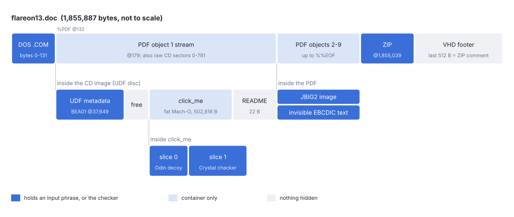

## 1. "It's corrupted"

My first move was to open it in WPS Office. It showed garbage, so I assumed the document was broken. It isn't. `file` just says `data`, and the first bytes are not a Word header at all:

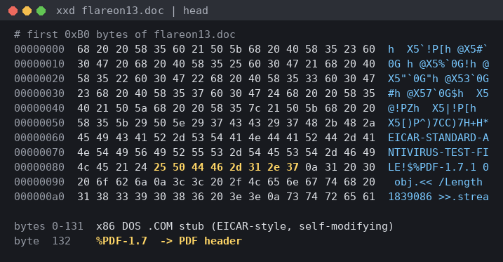

Two things stand out:

- Bytes `0-131` are printable x86 code in the style of the EICAR antivirus test file (`h  X5`!P[...`), ending in the string `EICAR-STANDARD-ANTIVIRUS-TEST-FILE!$`.
- At byte `132` there is a PDF header, `%PDF-1.7`.

A quick signature grep found more:

```
$ grep -abo -E '%PDF|BEA01|NSR02|%%EOF' flareon13.doc
132:%PDF
37649:BEA01
40001:NSR02
51786:NSR02
89418:NSR02
1855033:%%EOF
```

`BEA01` and `NSR02` are UDF volume recognition markers, so there is also an optical disc image in here.

> Windows Defender may flag the file because of the EICAR-style stub. I did all of this in WSL.

## 2. The CD image

The odd offset of `BEA01` (37649) was the clue. In a normal ISO, the volume descriptors start at sector 16 of 2048-byte sectors, so offset `32768`. Here it is `16 * 2352 + 17`. That means the whole file, from byte 0, is a raw CD image with 2352-byte sectors: 12 bytes of sync (`00 FF*10 00`), a 4-byte header, 2048 bytes of user data, then EDC/ECC.

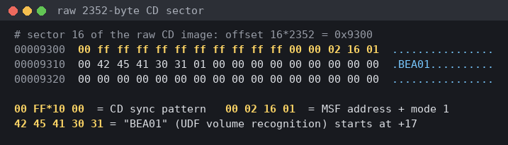

The DOS stub and the PDF header sit inside the first few sectors, which a disc never uses for files, so they don't break the CD.

I wrote [raw2iso.py](files_found/raw2iso.py) to keep only the 2048 data bytes of each sector:

```python
d = open('flareon13.doc', 'rb').read()
n = len(d) // 2352
with open('disc.iso', 'wb') as f:
    for i in range(n):
        f.write(d[i*2352 + 16 : i*2352 + 16 + 2048])
```

The result has only a UDF filesystem (no ISO9660 part), but 7-Zip opens it. It holds two files, `click_me` and `README.TXT`:

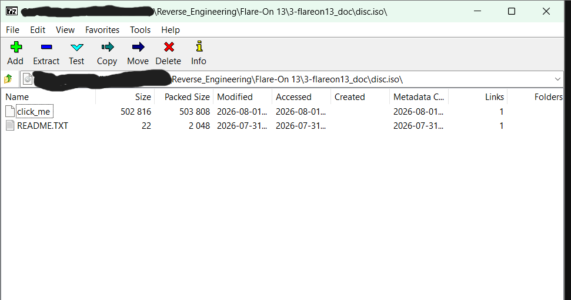

The UDF properties show it was burned with the Apple Disc Recording framework, and 7-Zip warns that there is data after the end of the payload (that's the rest of the polyglot):

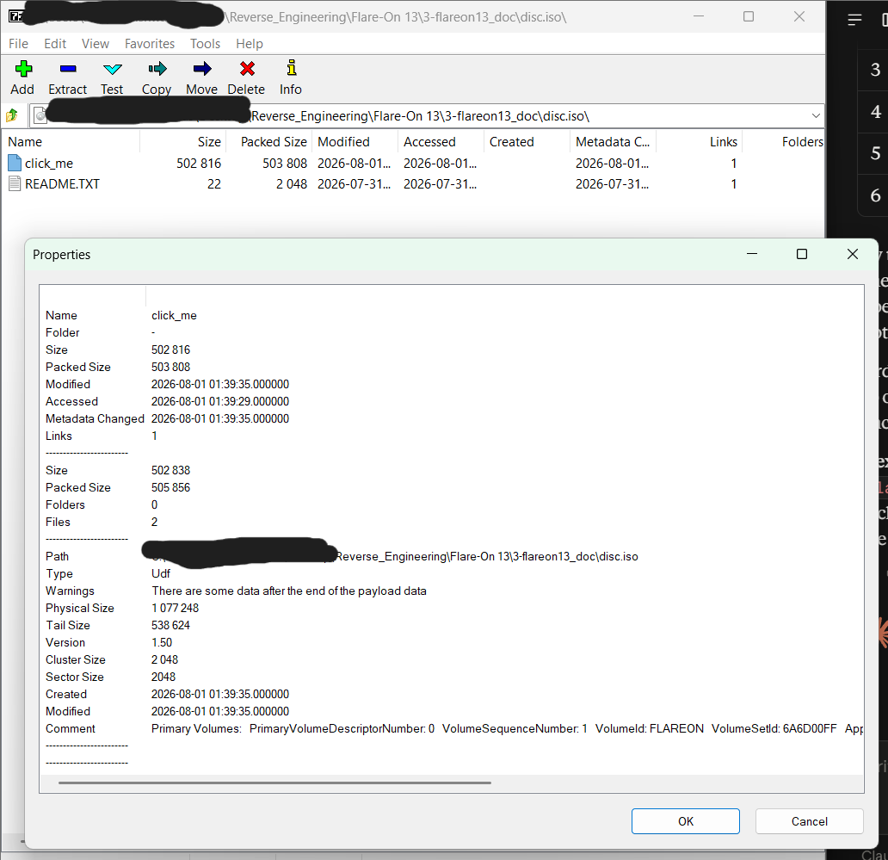

`README.TXT` only says `benign corpus payload`. I checked it with and without the newline, and the slack space after both files on the disc. Nothing there.

## 3. click_me: a fat Mach-O with a decoy

`click_me` is a macOS universal ("fat") binary:

```
click_me: Mach-O universal binary with 2 architectures: [arm64] [arm64 subarchitecture=3]
```

Both slices are arm64. Normally a universal binary holds one build per CPU type, and arm64 uses subtype 0 (or 2 for arm64e). Subtype 3 is not standard, and the second slice is six times bigger than the first:

| Slice | CPU subtype | Offset | Size |
|---|---|---|---|
| 0 | 0 (ARM64_ALL) | 16384 | 68,560 |
| 1 | 3 (non-standard) | 98304 | 404,512 |

[split_fat.py](files_found/split_fat.py) cuts them apart:

```python
d = open('click_me', 'rb').read()
open('slice0_arm64.bin', 'wb').write(d[16384 : 16384 + 68560])
open('slice1_sub3.bin',  'wb').write(d[98304 : 98304 + 404512])
```

`strings` on both:

- **slice0** is tiny. It's written in Odin (`runtime::default_random_generator_proc`), imports only `ptrace`, `usleep`, `write` and three memory functions, and contains `totally_fake_flag` plus a taunt: `Strings ? Where we're going, we don't need strings...`
- **slice1** is written in Crystal (`Fiber::ExecutionContext`, `String::Builder`). The author changed all of the runtime's error messages into leetspeak (`1nd3x 0u7 0f b0und$`), and it's stripped.

I decided slice0 was the decoy and slice1 was the real challenge. Half right. That decision cost me the most time later on.

I can't run either of them because I'm on Windows x64 with no Mac.

## 4. Reversing slice1 (the checker)

I loaded slice1 into Ghidra and had Claude.ai help me read it. From the entry point, `FUN_100035510` is Crystal's own `main(argc, argv)`: it installs signal handlers, sets up STDOUT/STDERR, calls `FUN_100000750` (`__crystal_main`, where the program's top-level code lives), runs the `at_exit` handlers and flushes the output.

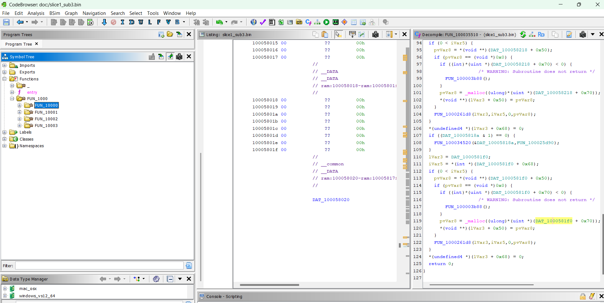

`crystal_main` is about 3,100 instructions. Roughly the first 40% is just Crystal initialising constants (lots of `FUN_100034520(&flag, init_fn)` calls). The actual logic starts after the last of those, around `0x100001bdc`. Once you know what to look for, it's three textbook algorithms:

- a table starting `0xd76aa478` and the init value `0x67452301`: **MD5**
- round constants generated at runtime with integer square and cube roots, and a message schedule with `ror 7/18, shr 3`: **SHA-256**
- a 256-entry S-box, swaps, and `S[(S[i]+S[j]) & 0xff] ^ byte`: **RC4**

What the program does:

1. Reads **6 lines** from stdin.
2. Computes `MD5(line)` for each raw line and removes it from a set of 6 stored digests if it matches. Order doesn't matter.
3. Two hard checks before the flag code runs: exactly 6 lines were read (`cmp w8, #6` at `0x10000273c`), and the set is now empty (`cbnz` right after). Any miss goes to the failure path.
4. Builds a 32-byte key: `SHA-256(line1) ^ SHA-256(line2) ^ ... ^ SHA-256(line6)`.
5. RC4-decrypts a 40-byte ciphertext with that key and prints it.

So every one of the six lines is required, and every one of them feeds the key. No shortcut.

The six target digests aren't stored as text. Each one is built as four 8-byte immediates, and every byte is `0x80 | index` into `0123456789abcdefghijklmnopqrstuvwxyz`. So `0x8d` is `d` and `0x88` is `8`:

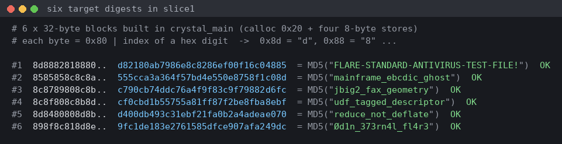

The ciphertext is hidden the same way, in 80 bytes where every two low nibbles pack into one byte (the routine at `FUN_100033ef8`, `bfi w13, w12, #4, #28`). That gives 40 bytes, and a 40-byte flag ending in `@flare-on.com` fits.

At this point the challenge was clear: find six strings in the polyglot whose MD5s match those six digests.

## 5. The six lines

Every part of the file hides exactly what its own format is known for. You only see each line after decoding that part the way its format expects.

### Line 1: the DOS stub

The first 132 bytes are a 16-bit DOS `.COM` program written only with printable characters, like the real EICAR file. It modifies itself and then prints with `INT 21h / AH=09h`. I ran it in Unicorn ([emulate_com.py](emulate_com.py)):

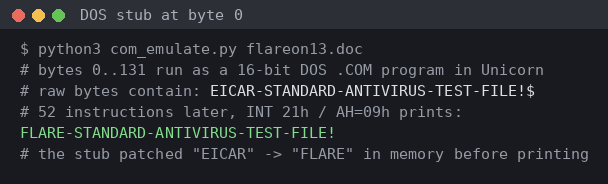

The file contains `EICAR-STANDARD-...` as plain text, but the stub patches it in memory before printing, so the actual line is `FLARE-STANDARD-ANTIVIRUS-TEST-FILE!`. Hashing what `strings` shows gets you the wrong answer.

### Line 2: invisible EBCDIC text in the PDF

The PDF is encrypted (RC4, revision 2, 40-bit), but both the user and owner passwords are empty, so `qpdf --decrypt` or `pikepdf` opens it without one. Object 1 is one huge stream (`/Length 1839086`) that wraps the CD sectors. The page is enormous on purpose: `MediaBox [0 0 14400 14400]` with `UserUnit 75000`, so normal viewers render nothing useful (PyMuPDF even refuses with "Overly large image"). That's probably why WPS showed garbage.

The page content draws the FLARE logo out of 20 vector polygons:


The end of the content stream has the interesting part:

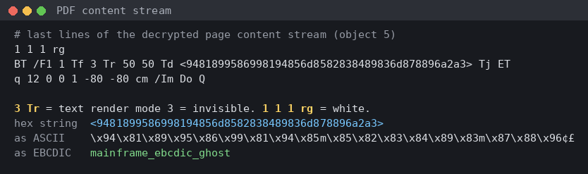

White text (`1 1 1 rg`), render mode `3 Tr` (invisible), as a hex string. As ASCII it's junk. As EBCDIC (code page 037, the mainframe encoding) it's `mainframe_ebcdic_ghost`.

### Line 3: the JBIG2 image

The page also draws an XObject `/Im`: an 808x48, 1-bit image compressed with `JBIG2Decode`, the fax-oriented codec. It's drawn with `12 0 0 1 -80 -80 cm`, so it ends up squashed and off the page. Extracting the image itself gets around that:

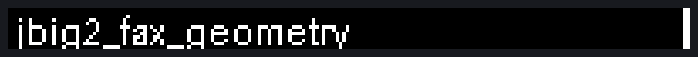

`jbig2_fax_geometry`.

### Line 4: UDF metadata

This one is plain ASCII at offset `49653`, inside the UDF Logical Volume implementation-use area next to `OSTA Compressed Unicode` and `*UDF LV Info`. It's the only one of the six you can find with `strings`:

```
udf_tagged_descriptor
```

### Line 5: the ZIP after %%EOF

ZIP readers parse from the end of a file, so a ZIP is appended after the PDF's `%%EOF`, at offset `1855039`. It holds one encrypted entry, `flag.txt`:

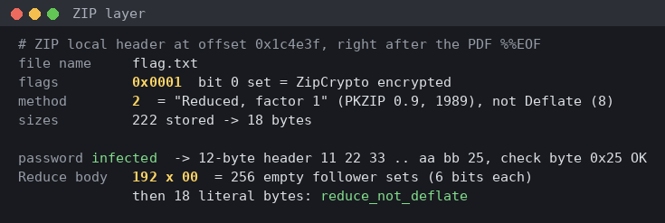

Two old tricks stacked here:

- **ZipCrypto** with the password `infected`, the standard password for zipped malware samples.
- **Compression method 2**, "Reduced with factor 1", from PKZIP 0.9 in 1989. Almost nothing supports it anymore, which is why it's not Deflate.

After decryption, the Reduce stream starts with 192 zero bytes. Those are 256 empty "follower sets" at 6 bits each, so every following byte is a plain literal: `reduce_not_deflate`.

One trap: ZipCrypto only checks one byte of the header against the CRC, so a wrong password passes 1 time in 256. Here `flag` also passed the check byte but gave garbage. Always look at the output, not just the check byte.

### The VHD footer (no line)

The last 512 bytes are a Microsoft Virtual PC / VHD footer (`conectix`, fixed disk, creator `vpc 5.0`, host `Wi2k`, unique ID `FLAREONPOLYGLOT!`, valid checksum). It's also the ZIP comment: the ZIP end-of-central-directory record has a 512-byte comment that is exactly this footer. A VHD reader sees the rest of the file as the disk contents, which is the same CD image again.

It holds no line. It's there to make the file one more valid format.

### Line 6: the decoy's runtime output

This is the one I missed for a long time (see section 7). slice0 doesn't store its message as text. Its `__const` section holds 256-colour ANSI codes XORed with `0x80` and a brightness ramp ` .,:;=+...`, which it uses to animate a flame in the terminal with `write` and `usleep`. It also calls `ptrace` (normally `PT_DENY_ATTACH`, an anti-debug trick).

Without a Mac, I emulated it with Unicorn ([emulate_decoy.py](emulate_decoy.py)). The slice only has seven imports, so each one gets a tiny Python stand-in: `write` copies the bytes into a buffer, `usleep` counts frames, `ptrace` returns 0. Rendering the captured terminal output after 20 frames:

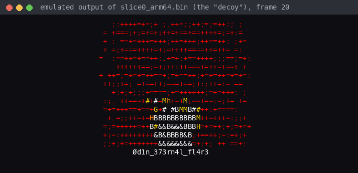

Under the flame, every frame:

```
Ød1n_373rn4l_fl4r3
```

"Odin eternal flare" in leetspeak, which fits a binary written in Odin. The first character is `Ø` (UTF-8 `C3 98`), and those bytes don't appear anywhere in the binary, because the string is generated at runtime. MD5 is `9fc1de183e2761585dfce907afa249dc`, the last missing digest.

So the challenge text's "contrast these results with how well you did with executables" was a direct hint. The executable you're meant to dismiss holds the last line.

## 6. Getting the flag

With all six lines, [solve.py](solve.py) checks the MD5s, builds the XOR-of-SHA-256 key and runs RC4 on the 40-byte ciphertext:

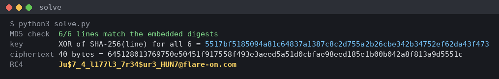

The input you'd give the real binary (in any order):

```
FLARE-STANDARD-ANTIVIRUS-TEST-FILE!
mainframe_ebcdic_ghost
jbig2_fax_geometry
udf_tagged_descriptor
reduce_not_deflate
Ød1n_373rn4l_fl4r3
```

## 7. Where I went wrong

The challenge isn't that deep once you see it. Most of my time went on these:

1. **Trusting the extension.** WPS showing garbage made me think the file was corrupted. Running `file` and a hexdump straight away would have shown the polyglot immediately.

2. **A fake "crack" from another AI.** At one point another assistant gave me a table claiming the six hashes were `the quick brown fox jumps over`. It was invented. `md5("the")` is `8fc42c6ddf9966db3b09e84365034357`, nothing like the target. Re-hash any claimed crack yourself.

   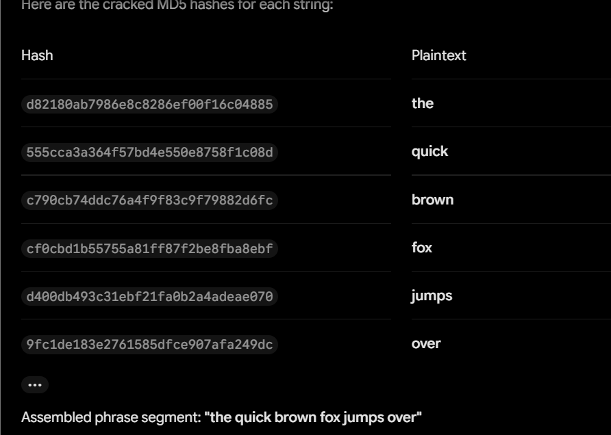

3. **Online hash lookups.** CrackStation found 0 of 6. That was useful in one way: it showed the lines aren't dictionary words, so they have to be found in the file rather than cracked.

   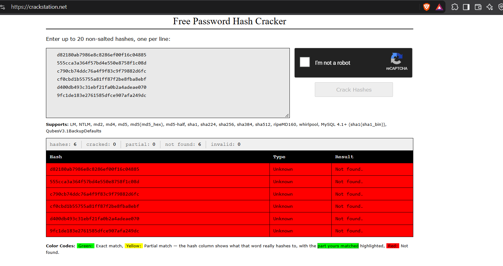

4. **Getting the key derivation wrong at first.** I first read it as a SHA-256 chain over the lines in input order, which would make order matter. It's an XOR of six independent hashes, so order doesn't matter.

5. **Brute-forcing the last line.** After five lines all looked like `word_word_word`, I brute-forced billions of snake_case combinations of format and technique words (VHD, Mach-O, CD terms) against the last digest. It could never have worked: the real line starts with a non-ASCII `Ø`.

6. **"One line per format, so the last one must be the VHD."** Wrong reasoning. The PDF holds two lines, so the mapping isn't one per format, and the lines aren't in file-offset order either. I spent a lot of effort on the VHD because of this. Trying to open it as a VHD on Windows also went wrong: Explorer hid the real `.doc` extension, so the copy was `flareon13.vhd.doc`, and 7-Zip identified it by content and opened it as the Mach-O instead:

   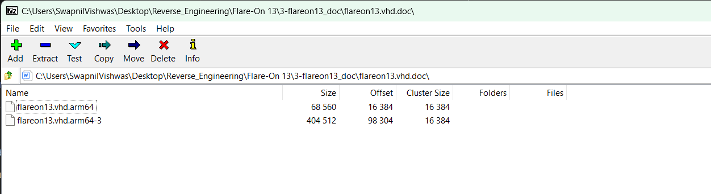

   7-Zip's `-tvhd` switch forces the VHD reader (`7z l -tvhd flareon13.vhd`), and once I did that the VHD turned out to contain nothing new.

7. **Chasing other dead ends.** The PDF owner password (empty), the PDF fill colours (just the logo palette), the gaps in the Mach-O fat header (all zeros), a "hidden font" (2,039 random `00 01 00 00` matches, no real font), the raw CD sector headers, and the Crystal string `true_honest_flag` next to the decoy's `totally_fake_flag` (just a joke, wrong hash).

8. **Dismissing the decoy.** This was the real mistake. I wrote slice0 off on the first `strings` run because it said `totally_fake_flag`. Its other string, "Where we're going, we don't need strings", literally says its content isn't in its strings. Running it was the answer, and since I couldn't run it natively, emulating it was the way.

9. **Copying the ciphertext out of order.** The decompiler shows the stores as `puVar87[1] = ...` before `*puVar87 = ...`. I typed the 8-byte words in the order they appear in the source instead of by address, so even with all six lines my first decryption gave garbage. Sorting the words by their offset fixed it.

## Flag

```
Ju$7_4_l177l3_7r34$ur3_HUN7@flare-on.com
```

"Just a little treasure hunt."

## Notes

What I learned from this one:

- **Check what a file really is before trusting its extension.** `file`, a hexdump and a grep for format signatures (`%PDF`, `PK\x03\x04`, `conectix`, `BEA01`, `\xca\xfe\xba\xbe`) would have mapped this file in five minutes.
- **In a polyglot, each format's reader looks at a different part.** DOS runs from byte 0, PDF searches for `%PDF`, CD readers use 2352-byte sectors from byte 0, ZIP and VHD read from the end.
- **Decode each layer the way its own format expects.** Several lines were invisible to `strings`: one is printed by code, one is EBCDIC, one is pixels, one is encrypted and Reduce-compressed, and one is generated at runtime.
- **A decoy can still hold a piece.** If a challenge has two binaries, figure out what both of them actually do before writing one off.
- **No Mac needed for a small arm64 Mach-O.** Unicorn plus a handful of stubbed imports is enough to run it.
- **Verify every "crack" yourself,** whether it comes from a website or an AI.
- **Brute force is the last resort.** Every line here was meant to be found, not guessed, and a quick look at slice0's behaviour would have saved hours.

## Files

- [solve.py](solve.py): checks the six lines and decrypts the flag offline
- [emulate_com.py](emulate_com.py): runs the DOS stub and prints line 1
- [emulate_decoy.py](emulate_decoy.py): runs slice0 in Unicorn and prints line 6
- [files_found/raw2iso.py](files_found/raw2iso.py), [files_found/split_fat.py](files_found/split_fat.py): extraction helpers
