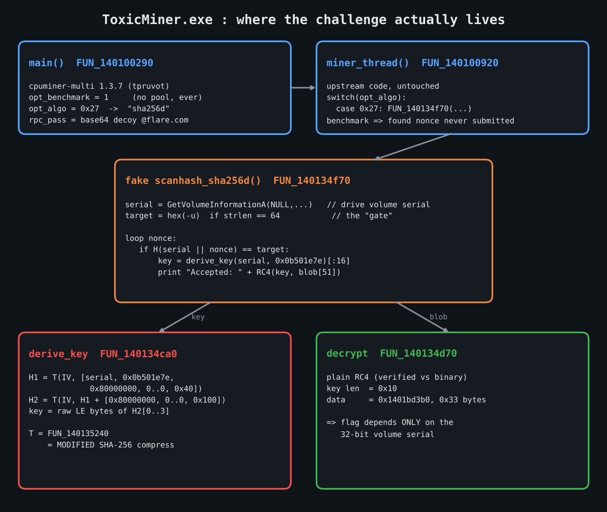
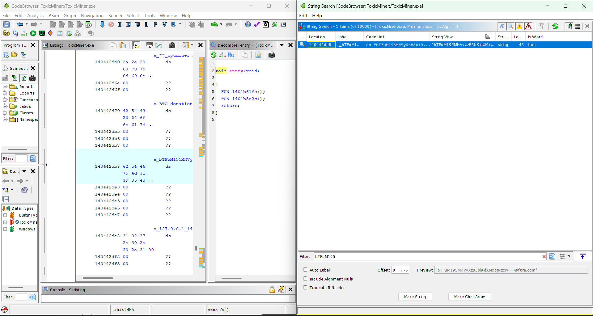
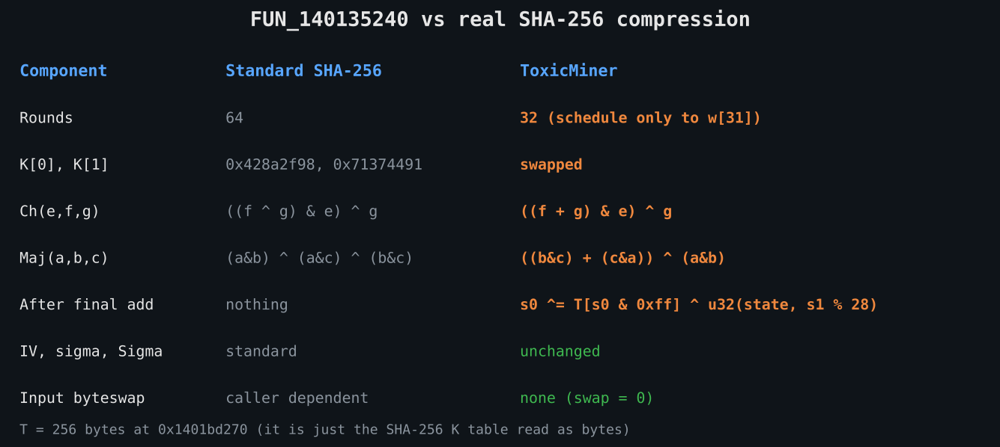
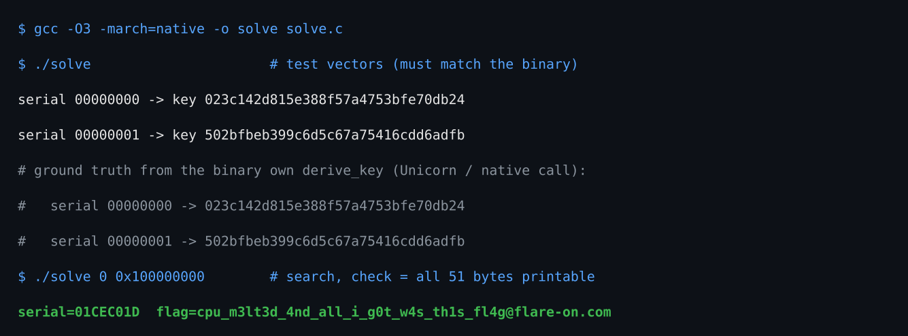
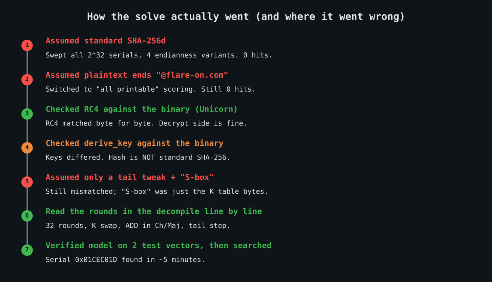

# Flare-On 13 (2026) — Challenge 4: ToxicMiner

> *"You may have noticed the ambient temperature in your room rising rapidly... We've chained your terminal to a rogue CPU miner... Dissect the binary before you bake alive, or at least generate enough hash rate to pay off the electricity bill for your captivity."*

| | |
|---|---|
| **File** | `ToxicMiner.exe` (PE32+ x64 console, ~4.8 MB) |
| **SHA-256** | `ee3a410dc86ea45a45c2aaedd071dd39b58035f066f8c9a134c93d4537a28a93` |
| **Tools** | Ghidra 11.x, Python (pefile, unicorn, capstone), gcc |
| **Flag** | `cpu_m3lt3d_4nd_all_i_g0t_w4s_th1s_fl4g@flare-on.com` |

---

## TL;DR

The binary is the open-source **cpuminer-multi 1.3.7 (tpruvot)** with one function replaced. The fake `scanhash_sha256d` reads the **volume serial number** of the current drive, hashes it with a **modified SHA-256d**, uses the first 16 bytes as an **RC4 key**, and decrypts a 51-byte blob into the flag. The mining "target" passed on the command line is only a gate; the key depends on nothing but the 32-bit serial.

Once the modified hash was understood and verified against the binary, recovering the author's serial (`0x01CEC01D`) was a 2³² search that hit in about 5 minutes.



---

## 1. Triage

`strings` immediately gives the game away about the base:

```
** cpuminer-multi 1.3.7 by tpruvot@github **
BTC donation address: 1FhDPLPpw1...
```

So 99% of the binary is upstream code. The job is to find what the author **changed**, not to reverse a miner.

One string does not belong upstream:

```
bTFuM195MHVyXzB3bl9idXMxbjNzcw==@flare.com
```

Base64 decodes to `m1n3_y0ur_0wn_bus1n3ss`. It looks like a flag but ends in `@flare.com`, not `@flare-on.com`. **Decoy.** Still useful as an anchor into `main`.



---

## 2. `main` (FUN_140100290)

Following the xref from the decoy string lands in `main`. Compared with upstream `cpuminer.c`:

```c
DAT_140495cf8 = _strdup(&DAT_140491c14);                       // rpc_user  (from -u)
DAT_140495cf0 = _strdup("bTFuM195MHVyXzB3bl9idXMxbjNzcw==");   // rpc_pass  (decoy)
DAT_140491be8 = _strdup("127.0.0.1");                          // rpc_url
...
FUN_140103180(argc, argv);          // parse_cmdline
DAT_140491aa8 = 1;                  // opt_benchmark FORCED on, after parsing
DAT_140441934 = 0x27;               // opt_algo FORCED, after parsing
```

- `opt_benchmark = 1` means the miner never talks to a pool. It only hashes locally.
- `opt_algo = 0x27` overrides whatever algo you pass. Index `0x27` in the algo name table (`PTR_s_keccak_140441700`) is **`sha256d`**.

---

## 3. `miner_thread` (FUN_140100920)

Upstream, unchanged. The relevant part is the algorithm switch:

```c
case 0x27:
    iVar10 = FUN_140134f70(thr_id, work, max_nonce);   // scanhash_sha256d slot
    break;
```

And near the end:

```c
if ((iVar10 == 0) || (DAT_140491aa8 != 0)) goto LAB_140100b50;   // benchmark: never submit
```

In benchmark mode a found nonce is never submitted, so whatever the author wants to happen on a "solution" must happen **inside** `FUN_140134f70`.

---

## 4. The fake `scanhash_sha256d` (FUN_140134f70)

This is the whole challenge:

```c
if (DAT_140492b4c == 0) {
    GetVolumeInformationA(NULL, NULL, 0, &DAT_140492b48, NULL, NULL, NULL, 0);   // volume serial
    DAT_140492b4c = 1;
}
if (rpc_user && strlen(rpc_user) == 0x40) {        // -u must be 64 hex chars
    for (i = 0; i < 32; i++) sscanf(rpc_user + 2*i, "%2hhx", &target[i]);
    have_target = true;
}
do {
    nonce++;
    H = T( IV, [serial, nonce, 0x80000000, 0..0, 0x40] );   // first block
    H = T( IV, H + [0x80000000, 0..0, 0x100] );               // second block (the "d")
    if (have_target && memcmp(H, target, 32) == 0) {
        derive_key(serial, 0x0b501e7e, key);                  // FUN_140134ca0
        rc4(key, 16, blob_1401bd3b0, 0x33, out);              // FUN_140134d70
        log("Accepted: %s", out);
        exit(0);
    }
} while (nonce < max_nonce && !restart);
```

Key observations:

1. The **target from `-u` is only a gate**. It is never used to build the key.
2. `derive_key` takes the **serial** and a constant `0x0b501e7e`. Nothing else.
3. Therefore: **flag = RC4(first16(H(serial ‖ 0x0b501e7e)), blob)**, a function of one 32-bit value.

### Where does the serial come from?

Before searching anything, I checked whether the author planted or hinted at the serial. Xrefs in Ghidra:

| Address | Access | Meaning |
|---|---|---|
| `140134fce` | `LEA R9, [DAT_140492b48]` | output pointer for `GetVolumeInformationA` |
| `140135087` | READ | used in the hash loop |
| `1401351be` | READ | passed to `derive_key` |
| `140134ff1` | WRITE `DAT_140492b4c = 1` | "already fetched" flag |

Nothing else writes the serial. It comes **only** from the machine the binary runs on. So the author's serial has to be recovered, and the "generate enough hash rate" line in the challenge text is the hint that this is the final step.

---

## 5. `derive_key` (FUN_140134ca0) and decrypt (FUN_140134d70)

`derive_key` is the same double-hash pattern as the loop:

```
H1  = T(IV, [serial, 0x0b501e7e, 0x80000000, 0,0,0,0,0,0,0,0,0,0,0,0, 0x40])
H2  = T(IV, [H1[0..7], 0x80000000, 0,0,0,0,0,0, 0x100])
key = raw little-endian bytes of H2[0..3]          // copied with MOVUPS, 16 bytes
```

Call site confirms the parameters:

```asm
1401351be  MOV   ECX, dword ptr [DAT_140492b48]   ; serial
1401351c8  MOV   EDX, 0xb501e7e                   ; constant
1401351cd  CALL  FUN_140134ca0                    ; derive_key
1401351d2  MOVUPS XMM0, [RBP-0x20]                ; first 16 bytes of output
1401351da  MOV   R9D, 0x33                        ; 51 bytes
1401351e0  LEA   R8, [DAT_1401bd3b0]              ; ciphertext
1401351ec  MOV   EDX, 0x10                        ; key length 16
1401351fb  CALL  FUN_140134d70                    ; RC4
```

`FUN_140134d70` decompiles into ugly vectorized noise, but the structure is textbook RC4: identity fill of `S`, KSA with `key[i % 16]`, PRGA XOR. I confirmed it by emulating the real function (Unicorn) with a fixed key and comparing against a reference RC4: **byte-for-byte identical**.

Ciphertext at `0x1401bd3b0` (51 bytes):

```
f4f9659f31f3da5cf137a1b8cf90a1581eebe499a7c11b1502af7463d3b2192866de3de97163e775dfe4ab616fb90c2789fc87
```

---

## 6. The real twist: `FUN_140135240` is not SHA-256

`FUN_140135240(state, block, swap)` looks like cpuminer's `sha256_transform`: same IV, same σ/Σ rotation amounts, the familiar K constants. But emulating it on a known block gave **different output from real SHA-256 on all 8 words**, while my reference implementation was verified correct against `sha256("abc")`.

Reading the decompile carefully (instead of skimming the first few rounds) shows five changes:



**1. Only 32 rounds.** The schedule loop runs twice, producing 16 extra words (`w[16..31]`), and the last constant used is `0x14292967` = K[31].

**2. K[0] and K[1] swapped.** Round 0 pairs `w[0]` with `0x71374491`:

```c
iVar5 = (uVar6 + uVar13 & uVar7 ^ uVar13) + local_148._0_4_ + Σ1(e) + h + 0x71374491;
...
iVar5 = uVar13 + 0x428a2f98 + ... + local_148._4_4_;     // round 1 uses K[0] with w[1]
```

**3. Ch uses ADD instead of XOR.** `(uVar6 + uVar13 & uVar7 ^ uVar13)` is `((f + g) & e) ^ g`.

**4. Maj uses ADD.** `((uVar8 & uVar9) + (uVar9 & uVar10) ^ uVar8 & uVar10)` is `((b & c) + (c & a)) ^ (a & b)`.

**5. Tail scramble after the final add:**

```c
uVar13 = state[1];
state[0] = T_bytes[state[0] & 0xff] ^ *(uint *)((byte *)state + uVar13 % 0x1c) ^ state[0];
```

`T_bytes` at `0x1401bd270` starts `91 44 37 71 98 2f 8a 42 ...`, which is just the SHA-256 K table read as bytes.

Note on signed constants: Ghidra prints several K values as negatives (`-0x4a3f0431` = `0xb5c0fbcf`, `-0x54e3a12b` = `0xab1c5ed5`, ...). They are the standard values; only K[0]/K[1] order changed.

### Verification

Before any search, the model was checked against the binary's **own** `derive_key` (run via Unicorn, then natively by mapping the PE image and calling it with a Win64 calling shim):

| serial | binary's `derive_key` | my model |
|---|---|---|
| `0x00000000` | `023c142d815e388f57a4753bfe70db24` | `023c142d815e388f57a4753bfe70db24` ✅ |
| `0x00000001` | `502bfbeb399c6d5c67a75416cdd6adfb` | `502bfbeb399c6d5c67a75416cdd6adfb` ✅ |

---

## 7. Recovering the serial and the flag

With a verified model, the remaining unknown is the author's 32-bit serial. The check used makes **no assumption about the flag format**: a candidate is accepted only if all 51 decrypted bytes are printable ASCII (with early exit on the first non-printable byte, which also makes it fast).

Solver (`solve.c`, needs `sbox.bin` = 256 bytes from `0x1401bd270`):

```c
static void transform(uint32_t st[8], const uint32_t m[16]) {
    uint32_t w[32];
    for (int i = 0; i < 16; i++) w[i] = m[i];
    for (int i = 16; i < 32; i++)
        w[i] = w[i-16] + (ROR(w[i-15],7) ^ ROR(w[i-15],18) ^ (w[i-15]>>3)) + w[i-7]
                       + (ROR(w[i-2],17) ^ ROR(w[i-2],19) ^ (w[i-2]>>10));

    uint32_t a=st[0], b=st[1], c=st[2], d=st[3], e=st[4], f=st[5], g=st[6], h=st[7];
    for (int i = 0; i < 32; i++) {                       // 32 rounds
        uint32_t ch = ((f + g) & e) ^ g;                 // ADD, not XOR
        uint32_t mj = ((b & c) + (c & a)) ^ (a & b);     // ADD, not XOR
        uint32_t t1 = h + (ROR(e,6) ^ ROR(e,11) ^ ROR(e,25)) + ch + K[i] + w[i];   // K[0]/K[1] swapped
        uint32_t t2 = (ROR(a,2) ^ ROR(a,13) ^ ROR(a,22)) + mj;
        h=g; g=f; f=e; e=d+t1; d=c; c=b; b=a; a=t1+t2;
    }
    st[0]+=a; st[1]+=b; st[2]+=c; st[3]+=d; st[4]+=e; st[5]+=f; st[6]+=g; st[7]+=h;

    uint32_t inner;                                      // tail scramble
    memcpy(&inner, (uint8_t *)st + (st[1] % 28), 4);
    st[0] ^= T[st[0] & 0xff] ^ inner;
}

static void derive_key(uint32_t serial, uint8_t key[16]) {
    uint32_t h1[8], h2[8];
    memcpy(h1, IV, 32); memcpy(h2, IV, 32);
    uint32_t m1[16] = {serial, 0x0b501e7e, 0x80000000, 0,0,0,0,0,0,0,0,0,0,0,0, 0x40};
    transform(h1, m1);
    uint32_t m2[16] = {h1[0],h1[1],h1[2],h1[3],h1[4],h1[5],h1[6],h1[7],
                       0x80000000, 0,0,0,0,0,0, 0x100};
    transform(h2, m2);
    memcpy(key, h2, 16);
}
// then: RC4(key, CT) and accept only if all 51 bytes are printable
```

Full source is in `solve.c` next to this writeup. Single core, ~1M candidates/s; the hit came in about 5 minutes:



```
serial = 0x01CEC01D
flag   = cpu_m3lt3d_4nd_all_i_g0t_w4s_th1s_fl4g@flare-on.com
```

Cross-check: calling the binary's real `derive_key` + RC4 natively with serial `0x01CEC01D` printed the same flag.

(For completeness, the intended in-binary path also works: on a machine with that serial, pass `-u` = hex of sha256d-variant(`0x01CEC01D` ‖ nonce) for a nonce the thread will reach, and it prints `Accepted: <flag>`. Not needed once the key derivation is understood.)

---

## 8. Where I went wrong (lessons)



| # | Wrong assumption | What disproved it | Lesson |
|---|---|---|---|
| 1 | The hash is standard SHA-256 because the IV and K constants look standard | Four full 2³² sweeps (endianness variants) with zero hits | **Recognizable constants do not mean an unmodified algorithm.** Verify the primitive against the binary before building on it. |
| 2 | The flag must end with `@flare-on.com` | Switched to "all printable" check, still zero hits | Use format-agnostic checks; but the real bug was upstream (#1). |
| 3 | Brute force first, understand later | Hours of wasted compute | Understand the whole data path first; brute force is the last step, only once the model is proven. |
| 4 | Only a small tail tweak; `0x1401bd270` is a custom S-box | Emulator still disagreed on all 8 words; the "S-box" bytes are the K table | Read **every** round of an unrolled function, not just the first few. |
| 5 | Model it by eye, then trust it | Fixed by building a ground-truth oracle | **Build an oracle early** (Unicorn emulation, or map the PE and call the function natively) and diff your model against it. |

What actually worked, in order:

1. Identify the upstream project and diff behaviour against it, focusing only on changed code.
2. Trace data flow: where does the key come from (only the volume serial), and who writes it (only `GetVolumeInformationA`).
3. Verify each primitive independently against the binary (RC4 ✅, hash ❌).
4. Read the modified primitive line by line and write down every deviation.
5. Verify the model on test vectors from the binary's own code.
6. Only then search the 32-bit space.

---

## Flag

```
cpu_m3lt3d_4nd_all_i_g0t_w4s_th1s_fl4g@flare-on.com
```
