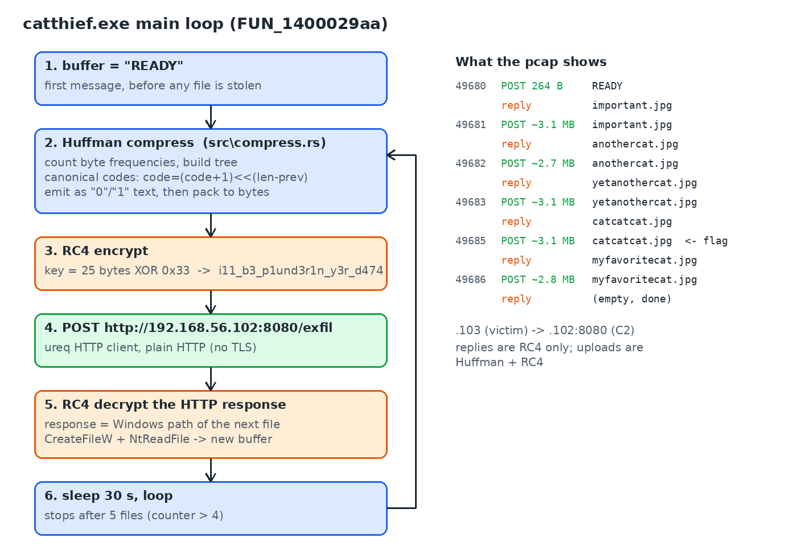
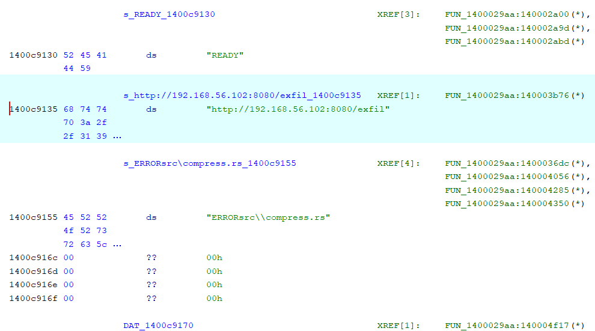
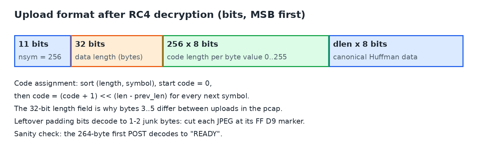
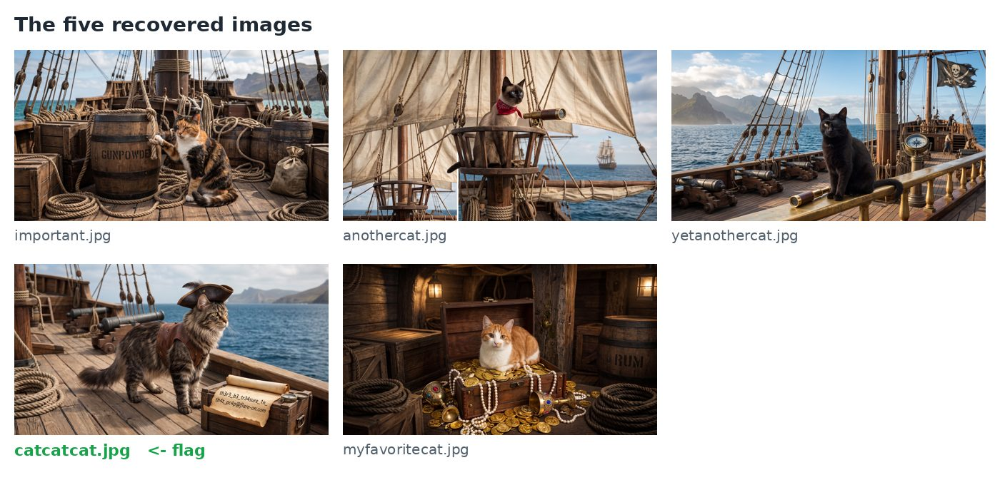

# Flare-On 13 (2026) - Challenge 5: catthief

> *"One of our stray laboratory felines just pilfered classified contraband from the server room... We've tossed the culprit's executable and a network packet capture into your enclosure so you can reconstruct the heist for the warden. Recover what the cat dragged out..."*

| | |
|---|---|
| **Files** | `catthief.exe` (PE32+ x64 console, Rust, ~1.3 MB), `capture.pcapng` (~15 MB) |
| **SHA-256** | `904e67200ac373a8929e04e799a805d57f0032325e6cf0bf808c69721cb94c22` (exe) |
| | `bdc90661caa86c1d9ccff8d04b1cef5ac656237813e17091687ebb0fa34decec` (pcap) |
| **Tools** | Ghidra, Wireshark, Python (no third-party packages needed for the solver) |
| **Flag** | `th3r3_b3_tr34sure_1n_th4t_pc4p@flare-on.com` |

---

## TL;DR

`catthief.exe` is a small Rust exfiltration client. It talks to a C2 at `http://192.168.56.102:8080/exfil` over plain HTTP. Each upload is **canonical-Huffman compressed** (the author's own `src\compress.rs`) and then **RC4 encrypted** with a hardcoded 25-byte key. Each server reply is an RC4-encrypted **Windows file path** telling the client which file to steal next.

The pcap holds one `READY` handshake and five stolen JPEGs. Recover the RC4 key from the binary, decrypt the server replies to learn the file names, write a Huffman decoder for the uploads, and look at the pictures. The obvious `important.jpg` is a decoy; the flag is in `catcatcat.jpg`.



---

## 1. Triage

### The binary

- PE32+ console executable. The strings are full of `.cargo\registry` paths and a `rustc/<hash>` path, so it is **Rust**.
- Crates pulled in: `ureq` (HTTP client), `rustls` / `ring` (TLS and crypto), `flate2` / `miniz_oxide`, `base64`. Most of these turned out to be noise.
- Only one source path does not belong to a library crate: **`src\compress.rs`**. That is the author's own code and the thing worth reading.
- Interesting strings sit right next to each other: `READY`, `http://192.168.56.102:8080/exfil`, `ERROR`.
- Imports `IsDebuggerPresent` and `AddVectoredExceptionHandler`. Worth knowing if you debug it, but static analysis was enough.

### The capture

| Direction | What it carries |
|---|---|
| `192.168.56.103` -> `192.168.56.102:8080` | ~14.9 MB of `POST` bodies |
| `192.168.56.102:8080` -> `.103` | six short HTTP replies, bodies of 36 to 40 bytes (last one empty) |

The server banner is Python `BaseHTTP`. No TLS, so every request and response is readable in Wireshark. There are **6 `POST /exfil` requests**:

- 1 small request, body 264 bytes
- 5 large requests, ~2.7 to 3.1 MB each

All bodies have high entropy, so they are compressed and/or encrypted.

### The first useful observation

Lining up the first 264 bytes of the five large bodies, they are **almost identical**. Only a handful of positions differ:

- bytes 3 to 5 differ in every body (looks like a **length field**)
- everything else differing is a few scattered bits

Two different files producing nearly the same ciphertext means the **same keystream is reused** for every message (fixed key, fresh cipher state each time) and the plaintexts start with a similarly structured header. So the plan became: find out how the key is made and what the header looks like.

---

## 2. Finding the main loop in Ghidra

Searching for the C2 string and following its references leads to one function, `FUN_1400029aa`. All three `READY` references, the URL reference and all four `ERROR` references come from it. This is effectively `main`.



> Note: the Ghidra decompile of this function is huge because Rust inlines `HashMap` (SwissTable) probing with SSE compares. All the `auVarXX[0] = -(pcVar1[0] == ...)` blocks are just hash table lookups. Read around them.

Reading the function top to bottom, ignoring the HashMap noise, it does this:

1. Put `"READY"` into a buffer.
2. **Count byte frequencies** of the buffer (HashMap `byte -> count`).
3. Build a Huffman tree from a min-heap: pop two nodes, merge, push back.
4. Get a code length per byte, sort, and assign **canonical codes**:
   ```c
   if (prev_len != 0) code = (code + 1) << (len - prev_len);
   ```
5. Encode the buffer as a **text string of `'0'` and `'1'` characters**, then pack it into bytes. The packing loop is easy to spot:
   ```c
   bVar45 = uVar19 == 0x31 | bVar45 * 2;   // 0x31 == '1'
   if (++iVar60 == 8) push(bVar45);
   ```
6. Write a bit-level header in front of the data. The helper is called with widths `0xb` (11 bits) and `0x20` (32 bits), then the length table and the data are appended.
7. Decode a 25-byte key and encrypt the whole thing (section 3).
8. `POST` it to `/exfil` with `ureq`. (The `testserver.rs` block in the decompile is inlined `ureq` library code. Ignore it.)
9. Decrypt the HTTP response with the same key and treat it as a **path**: `GetFullPathNameW` -> `CreateFileW` -> `NtReadFile`. The file contents become the next buffer. Any failure sets the buffer to `"ERROR"`.
10. Sleep 30 seconds (`FUN_1400745d0(0x1e, 0)`) and loop. It stops after five files (`if (4 < counter) return;`).

So the protocol is a simple pull: the client says `READY`, the operator answers with a path, the client uploads that file, and so on.

---

## 3. The key and the cipher

### The key

Just before encryption the function fills a 25-byte stack array and XORs it with `0x33`:

```c
local_291[0] = 0x5a; local_291[1] = 0x02; ... local_291[0x18] = 0x07;
for (i = 0; i != 0x19; i++) local_291[i] ^= 0x33;
```

```python
enc = [0x5a,0x02,0x02,0x6c,0x51,0x00,0x6c,0x43,0x02,0x46,0x5d,0x57,0x00,
       0x41,0x02,0x5d,0x6c,0x4a,0x00,0x41,0x6c,0x57,0x07,0x04,0x07]
print(bytes(b ^ 0x33 for b in enc).decode())
# i11_b3_p1und3r1n_y3r_d474
```

### The cipher: plain RC4

`FUN_1400052e2` is the key schedule:

```c
for (i = 0; i < 256; i++) S[i] = i;
for (i = 0; i < 256; i++) {
    j += S[i] + key[i % 25];   // shown by Ghidra as  i - (i/0x19)*0x19
    swap(S[i], S[j]);
}
state[0x100] = state[0x101] = 0;   // i, j
```

`FUN_140005281` is the stream generator, XORing each byte with `S[(S[i] + S[j]) & 0xff]`. No modifications, so any standard RC4 implementation (Python, CyberChef) matches it.

Because a fresh RC4 state is built for every message, **every message is encrypted with the same keystream**. That is exactly the near-identical-prefix pattern seen in the pcap.

---

## 4. What the operator asked for

The server replies are only RC4 encrypted (no compression), so decrypting them gives the file paths directly:

| Reply on port | Requested file | Uploaded on port |
|---|---|---|
| 49680 | `C:\Users\flare\Desktop\important.jpg` | 49681 |
| 49681 | `C:\Users\flare\Desktop\anothercat.jpg` | 49682 |
| 49682 | `C:\Users\flare\Desktop\yetanothercat.jpg` | 49683 |
| 49683 | `C:\Users\flare\Desktop\catcatcat.jpg` | 49685 |
| 49685 | `C:\Users\flare\Desktop\myfavoritecat.jpg` | 49686 |
| 49686 | *(empty, end of session)* | |

Five JPEGs. Now the uploads need decompressing.

---

## 5. The upload format

After RC4 decryption, each upload body is a bitstream read MSB first:



| Field | Size | Meaning |
|---|---|---|
| `nsym` | 11 bits | number of entries in the length table (always 256) |
| `dlen` | 32 bits | length of the encoded data in bytes |
| `lengths[256]` | 8 bits each | Huffman code length for byte values 0..255 (0 = unused) |
| data | `dlen * 8` bits | canonical Huffman codes |

Rebuilding the codes: take every `(length, symbol)` with a non-zero length, sort them, start with `code = 0`, and for every following symbol do `code = (code + 1) << (len - prev_len)`. Then walk the data bits and emit a byte whenever the accumulated bits match a code.

**Sanity check:** the 264-byte first upload decodes to `READY`. (It actually decodes to `READYDD`: the last byte is padded with zero bits, and zeros happen to be a valid code. The same 1 or 2 junk bytes appear at the end of each image, so each JPEG is cut at its final `FF D9` marker.)

---

## 6. The cats

Running the decoder on the five large uploads gives five valid 2816x1536 JPEGs:



`important.jpg` sounds like the obvious target, but Flare-On likes its decoys. The flag is written on the scroll in **`catcatcat.jpg`**:


```
th3r3_b3_tr34sure_1n_th4t_pc4p@flare-on.com
```

---

## 7. Solver

`solve.py` in this folder does the whole thing with only the Python standard library: it parses the pcapng, reassembles the TCP streams to port 8080, RC4-decrypts the replies to get file names, RC4-decrypts and Huffman-decodes the uploads, and writes the images to `recovered/`.

```
python solve.py capture.pcapng recovered
```

```
[49680] client -> b'READY'
[49680] server -> C:\Users\flare\Desktop\important.jpg
[49681] client -> important.jpg (3123324 bytes)
[49681] server -> C:\Users\flare\Desktop\anothercat.jpg
[49682] client -> anothercat.jpg (2738892 bytes)
[49682] server -> C:\Users\flare\Desktop\yetanothercat.jpg
[49683] client -> yetanothercat.jpg (3065529 bytes)
[49683] server -> C:\Users\flare\Desktop\catcatcat.jpg
[49685] client -> catcatcat.jpg (3084399 bytes)
[49685] server -> C:\Users\flare\Desktop\myfavoritecat.jpg
[49686] client -> myfavoritecat.jpg (2844616 bytes)
```

---

## Takeaways

- **Compare ciphertexts before reversing.** Five different files with near-identical first 264 bytes told us "fixed key, reused keystream, structured header" before opening Ghidra.
- **In Rust binaries, find the author's `src\*.rs` path.** Everything under `.cargo\registry` is library code. Here, `src\compress.rs` pointed straight at the interesting function.
- **Rust HashMaps decompile into walls of SIMD.** Recognise the SwissTable probe pattern and skip it.
- **A length table plus `(code + 1) << (len - prev)` means canonical Huffman.** The same layout (as in DEFLATE) shows up in plenty of custom compressors.
- **Decode every exfiltrated file.** The file named `important` was the decoy.
