# Flare-On 13 (2026) - Challenge 7: FlareCalc

> *"Our neuro-sadism department hypothesized that we could shatter a reverse engineer's sanity using nothing more than a basic Windows desktop calculator. Go ahead and punch in a few arithmetic equations while our EEG sensors record the exact millisecond you realize FlareCalc.exe is quietly plotting your demise. Please remember that weeping onto the keyboard will void your status as our favorite control-group subject."*

| | |
|---|---|
| **File** | `FlareCalc.exe` (PE32+ x64 GUI, MSVC static CRT, 1,507,488 bytes) |
| **SHA-256** | `0657ad6be44cfe3b0242fee6d17624e94329d5b25e1e1033d32c7121b099cee2` |
| **Tools** | Ghidra, Python (`capstone` for reading, `unicorn` for running decrypted snippets) |
| **Password** | `FLAREON_ASN1_Labyrinth_Key_2026!` |
| **Flag** | `t3mplat3s_asn_and_j1t_0h_my@flare-on.com` |

---

## TL;DR

`FlareCalc.exe` is a working calculator wrapped in about 2,500 junk functions. The real logic has three layers:

1. **The calculator gate.** A CRT initializer unmasks floating-point divide-by-zero, so `x / 0` raises an exception instead of returning `inf`. The `__except` filter reads the history of results and only continues if the last three were `22/7`, `88224646` and `8675309`.
2. **The hidden loader.** On success the program reads **its own Authenticode certificate table** (529 KB, a real one is a few KB) into RWX memory and jumps into it. The "certificate" is valid DER, but under a private OID `1.3.6.1.4.1.1337.1` it holds **1,035 encrypted records**. One of them is the loader itself.
3. **The labyrinth.** The loader checks a password one character at a time. Each character runs a different decrypted record, which updates a 32-byte state and returns the id of the next record. After 32 correct characters it reaches record `0x1185`, an **XTEA** routine that decrypts the flag (record `0x2706`) with the final state as the key.

Nothing ever prints the flag on its own. Entering the three numbers only arms the loader, which then waits for the password. The whole chain can be reproduced offline from the file, which is what `solve.py` does.

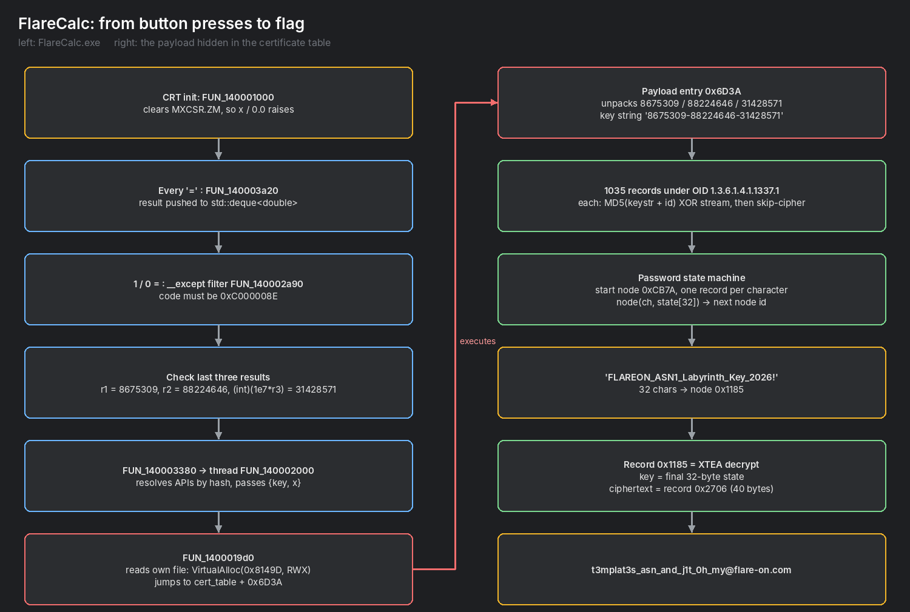

---

## 1. Triage

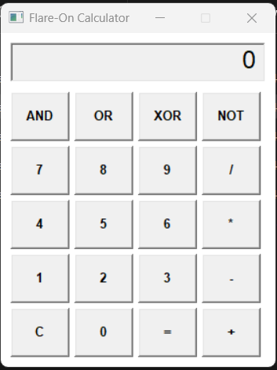

It is a normal-looking calculator: digits, `+ - * /`, `AND OR XOR NOT`, `C` and `=`.

Static facts worth knowing before opening Ghidra:

- `.text` entropy is 5.98, so it is not packed. The PE has `RELOCS_STRIPPED`, so it **always loads at `0x140000000`** and every address in this writeup can be used as-is in a debugger.
- The IAT has no `CreateThread`, `VirtualAlloc` or `ReadFile`. APIs are resolved at runtime by hash.
- There are 3,031 functions in `.pdata`. About **2,500 of them, between `0x140008c00` and `0x1400bb000`, are one template**: they mix constants into a global at `0x1400e2b00` and call each other when it is divisible by 3 or 7. I disassembled all of them and checked every reference to `0x1400e2b00`: **it is written and never read**. The whole block is noise, sprinkled through every real function to bury it.
- The security data directory is at file offset `0xEEC00`, size `0x814A0`, and runs to the end of the file. Everything after the first 64 KB of it has entropy 7.97. That is the first hint that the "signature" is a payload.

Two more patterns show up in every real function and can be ignored as soon as you recognise them:

```c
// 1. A global that is always 0 (it lives in .bss, 35 reads, 0 writes)
//    used to hide constants:  (DAT_1400e9228 + K1) ^ K2  ==  K1 ^ K2
local_68.cbSize = iVar1 + 0x6a5700f0U ^ 0x6a5700a0;     // = 0x50, sizeof(WNDCLASSEXW)

// 2. Dead loops whose result is never used
local_78 = 0x327;
do { local_78 = local_78 ^ uVar3; uVar3++; } while ((int)uVar3 < 5);
```

---

## 2. The window procedure and the decoys

`FUN_140006be0` registers the class `Flare-OnCalculatorClass` with `lpfnWndProc = FUN_140003b20`. The WndProc is the only place that touches the buttons:

| Global | Meaning |
|---|---|
| `DAT_1400e2a80` | display text (wide) |
| `DAT_1400e8f04` | pending operator (`+ - * / & \| ^`) |
| `DAT_1400e8f08` | left operand |
| `DAT_1400e9020` | expression history string |
| `DAT_1400e9238` | **`std::deque<double>` of every computed result** |

When `=` is pressed it checks the history string against four hardcoded expressions first. Each one XORs a stored blob with the expression text itself (`key[i % 7]`):

| Typed | What happens |
|---|---|
| `525+193` | shows `FLAG{NICE_TRY}` |
| `742*186` | shows `ACCESS DENIED` |
| `931-482` | shows `KEY_EXPIRED` |
| `843*952` | starts a thread that sends *"Never gonna give you up, Never gonna let you down..."* to its own window via `WM_COPYDATA`, which then scrolls in the display |

All four are decoys. The Rickroll is useful, though: it proves the hash-based thread creation, `FindWindowW` and the `WM_COPYDATA` marquee all work on your machine.

---

## 3. The calculator gate

### Unmasking divide-by-zero

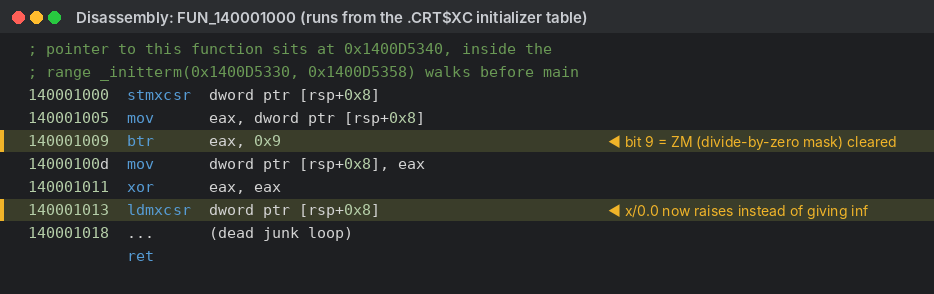

`FUN_140001000` has no callers. Its only reference is a pointer at `0x1400D5340`, inside the `.CRT$XC` table that `_initterm` runs before `main`. It clears bit 9 of `MXCSR` (the SSE divide-by-zero mask). From then on, `1.0 / 0.0` raises `0xC000008E STATUS_FLOAT_DIVIDE_BY_ZERO` instead of producing `inf`.

### The `__except` filter

Arithmetic goes through `FUN_140003a20`. Parsing its unwind info shows a `__try` around exactly one call:

```
scope 0x140003aa1 - 0x140003aef   filter 0x1400d3910   target 0x140003aef
```

- `0x140003aa5` calls the operator table in `FUN_140003570`. A divide by zero faults here.
- `0x140003abf` pushes the result onto the deque. **A faulting `=` never reaches it**, so the trigger itself does not pollute the history.
- The handler target `0x140003aef` is `xorps xmm6, xmm6`, which is why the display shows **`0`** after `1/0=` and not `inf`.
- The filter `0x1400d3910` is a thunk to `FUN_140002a90`, a 2 KB function with no static callers.

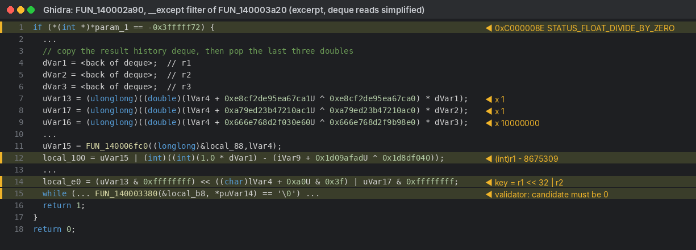

With the always-zero global substituted, the filter pops the last three results `r1` (newest), `r2`, `r3` and builds:

```
candidate = ((int)(1e7 * r3) - 31428571)   // inside FUN_140006fc0
          | ((int)r2 - 88224646)           // inside FUN_140006fc0
          | ((int)r1 - 8675309)
key       = ((u64)r1 << 32) | (u64)r2      = 0x00845FED05423386
x         = (u64)(1e7 * r3)                = 0x01DF8FDB
```

The validator `FUN_140003380` continues only if `candidate == 0`. So the last three results must be:

| | Required | Reading |
|---|---|---|
| `r3` | `(int)(1e7 * r3) == 31428571` | `22 / 7 = 3.142857142857...`, the schoolbook pi |
| `r2` | `88224646` | |
| `r1` | `8675309` | Jenny's number |

I confirmed this by emulating the real filter on a deque holding `[22/7, 88224646, 8675309]`: it returns 1 and hands `0x0` to the validator.

### Entering it

One trap: **a result is only pushed when `=` actually performs an operation.** Typing `88224646` and pressing `=` with no operator pending does nothing. Make every `=` compute something:

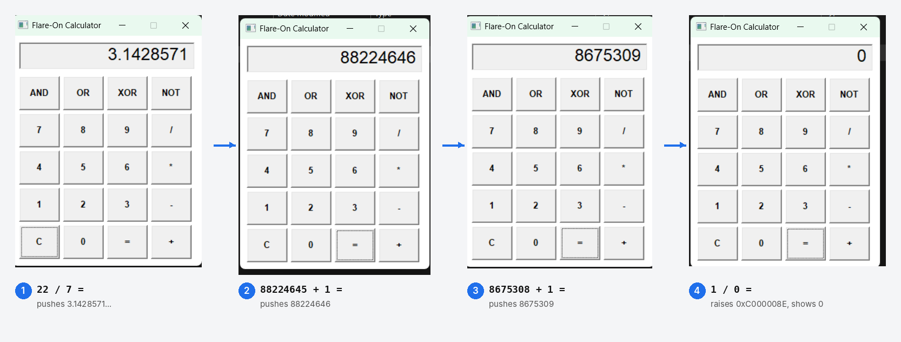

### Where it goes next

On success the validator resolves the thread API by hash (`FUN_140001560`, the same hash `0x2D0CA5F7` as the Rickroll) and starts `FUN_140002000` with `{key, x}`. That function resolves `GetModuleFileNameW`, `CreateFileW`, `SetFilePointer`, `ReadFile`, `VirtualAlloc` and `CloseHandle` from the PEB, and hands over to `FUN_1400019d0`:

```c
// FUN_1400019d0, constants decoded
GetModuleFileNameW(NULL, path, 0x104);
h   = CreateFileW(path, GENERIC_READ, FILE_SHARE_READ, NULL, OPEN_EXISTING, FILE_ATTRIBUTE_NORMAL, NULL);
SetFilePointer(h, <security dir offset> /* 0xEEC00 */, NULL, FILE_BEGIN);
buf = VirtualAlloc(NULL, 0x8149D, MEM_COMMIT | MEM_RESERVE, PAGE_EXECUTE_READWRITE);
ReadFile(h, buf, 0x8149D, &n, NULL);
CloseHandle(h);
((void(*)(u64, u64))(buf + 0x6D3A))(key, x);      // jump into the "certificate"
```

---

## 4. The payload in the certificate

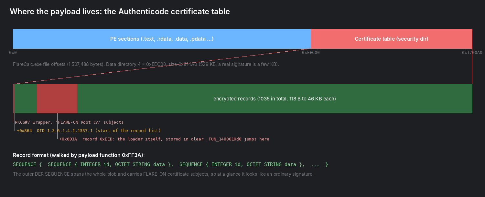

The certificate table is a real PKCS#7 blob with `FLARE-ON Root CA` subjects, so at a glance it looks like an oversized signature. At `+0x864` it contains the OID `1.3.6.1.4.1.1337.1` (`2b 06 01 04 01 8a 39 01`), followed by a DER list:

```
SEQUENCE {
    SEQUENCE { INTEGER id, OCTET STRING data },
    SEQUENCE { INTEGER id, OCTET STRING data },
    ...                                   // 1,035 records, 118 bytes to 46 KB each
}
```

The payload function `0xFF3A` walks exactly this structure to find a record by id. Record `0xEED` (46,500 bytes) starts at `+0x6D3A` and is stored **in clear**: it is the loader the EXE jumps into. Its first act confirms the gate:

```
0x6e2d  (0 + 0x6c2f5d5522a540e0) ^ 0x6c2f5d5522a540c0 = 0x20   ->  key >> 32        = 8675309
0x6e60  (0 - 0x5436168f70237021) ^ 0xabc9e97070237020 = ~0u    ->  key & 0xFFFFFFFF = 88224646
0x6e94  (0 - 0x149b8a74bda19f81) ^ 0xeb64758bbda19f80 = ~0u    ->  x   & 0xFFFFFFFF = 31428571
```

and turns them back into the string **`8675309-88224646-31428571`**, which keys everything after this point.

### Record decryption

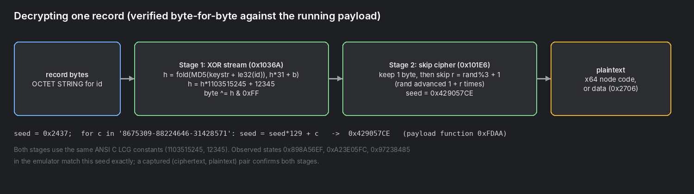

Every other record is decrypted in two stages before being run (code) or used (data):

| Stage | Payload function | What it does |
|---|---|---|
| key | `0x1076A` / BCrypt | `MD5("8675309-88224646-31428571" + le32(id))` |
| 1 | `0x1036A` | fold the MD5 into `h` with `h = h*31 + b`, then for each byte `h = h*1103515245 + 12345` and XOR with `h & 0xFF` |
| 2 | `0x101E6` | keep one byte, then skip `r = rand() % 3 + 1` bytes; `rand` is the same LCG, advanced `1 + r` times per byte |
| seed | `0xFDAA` | `h = 0x2437; h = h*129 + byte` over the key string, giving `0x429057CE` |

I did not trust this until it matched the running payload. Running the loader in Unicorn and hooking `0x101E6` gave a real (ciphertext, plaintext) pair: `40 fc 53 da 0b 48 01 83 ...` turned into `40 53 48 83 ec 20 48 8b ...` (`push rbx; sub rsp, 0x20; ...`). The Python reimplementation reproduces that pair byte for byte, and its PRNG states (`0x898A56EF`, `0xA23E05FC`, `0x97238485`) match the ones observed in the emulator.

### Runtime APIs

The loader resolves everything with its own export hash (`0xC8B2`). Hashing a list of API names with that same routine identifies them:

| Group | APIs |
|---|---|
| memory | `GetProcessHeap`, `RtlAllocateHeap`, `HeapFree`, `GetProcessHeaps`, `HeapWalk`, `VirtualAlloc`, `VirtualFree` |
| crypto | `BCryptOpenAlgorithmProvider` (`MD5`), `BCryptCreateHash`, `BCryptHashData`, `BCryptFinishHash` |
| network | `WSAStartup`, `gethostname`, `getaddrinfo`, `socket`, `bind`, `WSAIoctl`, `recv`, `send`, `inet_ntop`, `closesocket` |
| UI | `FindWindowW("Flare-OnCalculatorClass")`, `SendMessageW(WM_COPYDATA, dwData = 0xC3F12A8B)` |

The `addrinfo` hints are `AF_INET` / `SOCK_RAW`, combined with `WSAIoctl`. So the loader binds a raw socket to the host's own address and reads packets from it, rather than listening on a TCP port (which is why nothing new shows up in `netstat`). Replies go back with `send`, and results are scrolled in the calculator display through the same `WM_COPYDATA` channel as the Rickroll. I did not fully reverse the packet format the loader expects on the wire; the solve below does not need it, because the password check can be run directly.

---

## 5. The labyrinth

The command handler feeds received bytes one at a time to the record runner `0x113AE`:

```
node = 0xCB7A                       // start, set at 0x8647
for each byte ch:
    node = run(decrypt(record[node]), ch, state[32])
when node == 0x1185:
    run record 0x1185 with key = state[32] on record 0x2706  ->  plaintext to the display
```

`state` lives at `obj+0x29` and starts as 32 zero bytes. Every node is a small x64 function with a different body. Here is the second one:

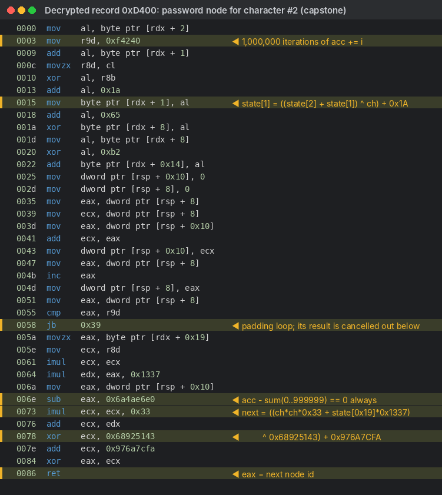

Two things make this look worse than it is:

- **The million-iteration loop is padding.** Every node sums `0..999999` and then subtracts (or adds the negation of) `0x6A4AE6E0`, which is exactly that sum mod 2³². The term is always 0. It exists to make tracing or emulating each step painfully slow.
- **Wrong characters do not crash.** They return an id that is not in the record table, so the walk simply stops. A few wrong characters land on a real record and lead into a short dead end, hence "Labyrinth".

That makes the search a plain depth-first walk: at each node, try the printable characters and follow the ones whose result is an existing record id. Only `F` works at the start; only `L` works after it; and so on:

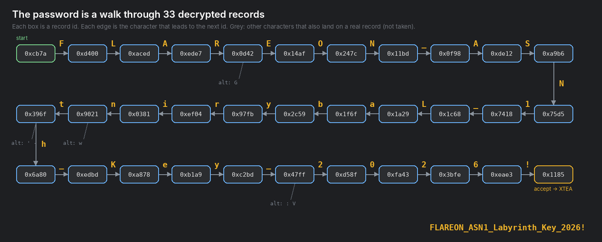

There are only four places where more than one character leads to a real record, and the wrong branches die within a step or two. The full walk visits 34 records and takes a few seconds:

```
FLAREON_ASN1_Labyrinth_Key_2026!
```

### The flag

Record `0x1185` decrypts to an XTEA routine (`delta = 0x8C032FC1 ^ 0x12345678 = 0x9E3779B9`, 32 rounds, 128-bit key from `k[i] ^ k[i+16]` of the 32-byte state, five 8-byte blocks). Record `0x2706` decrypts to 40 bytes of ciphertext. Running one on the other with the final state as the key:

```
state  = 670daa0ff05e7d85472eeb55a716a7b88d63019c27ee22ea447fd4fde87c013d
flag   = t3mplat3s_asn_and_j1t_0h_my@flare-on.com
```

---

## 6. Solver

`solve.py` in this folder does the whole thing from the EXE, without running it:

1. carve the certificate table and parse the 1,035 records,
2. decrypt records with the two-stage scheme,
3. run each node with Unicorn (with the padding loop shortened, checked against the original code on two probes per node),
4. depth-first search from `0xCB7A` to `0x1185`,
5. run the XTEA record on the ciphertext record.

```
pip install unicorn
python solve.py FlareCalc.exe
```

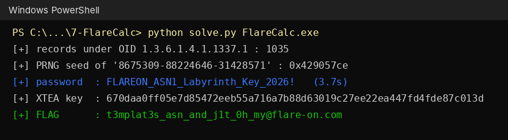

Two details are required for it to work:

- **Flush Unicorn's translation cache** (`ctl_remove_cache`) every time the code buffer is reused. Otherwise Unicorn keeps executing the previous node's code.
- **Use the in-file record ids**, not anything read out of a register, and **seed both stages from `0x429057CE`** for every record.

---

## Wrong turns

- **Hunting in the 2,500 mixer functions.** They update a global that is never read. Checking every reference to it once saved a lot of time.
- **Expecting the flag on screen after the gate.** After `22/7`, `88224646`, `8675309`, `1/0=` the display shows `0` and nothing else happens. That is correct: the gate only starts the loader, and the loader waits for the password.
- **Calling it a C2 shell, then a TCP server.** The `[-] Unknown command.` string and the socket APIs suggested a network service. `netstat` showed no new listener; the two odd ports belonged to an unrelated process:

  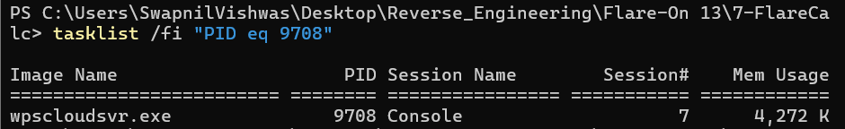

- **Guessing decryption parameters statically.** RC4 and AES with the MD5 key, and several seed guesses, all failed. What worked was capturing one real (ciphertext, plaintext) pair from the emulated loader and fitting the algorithm to it.
- **A mislabelled value.** `0x1498` looked like a record id; it was the low 16 bits of the blob length `0x81498`, read from a register.
- **A Unicorn cache bug.** Reusing one code buffer without flushing the JIT cache made every node after the first run the wrong code, so the password search found nothing. With the flush it finds the password in seconds.

---

## Takeaways

- **Check the security directory.** A 529 KB "signature" on a calculator is not a signature. Data in the certificate table sits outside every section, so it is never mapped and only visible if the program reads its own file.
- **Exceptions are control flow.** Unwind info (`.pdata` / `UNWIND_INFO` scope tables) shows filters and handlers that have no direct callers.
- **Read the gate as an equation.** `a | b | c == 0` with each term a difference means every term must be exactly zero; that gives the three numbers directly.
- **Fit the cipher to ground truth.** Once a known plaintext is available, every parameter can be proven instead of guessed.
- **Per-character oracles collapse brute force.** A check that fails early on the first wrong character turns a 95³² search into roughly 95 × 32 tries.
