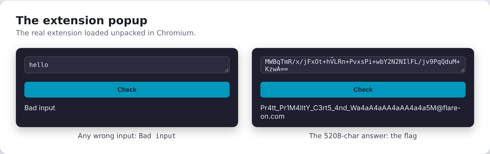
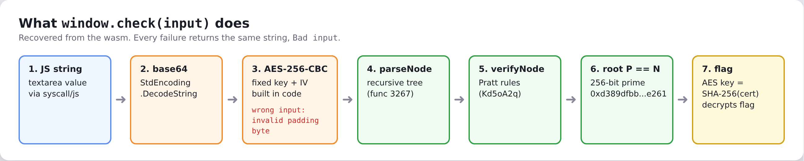
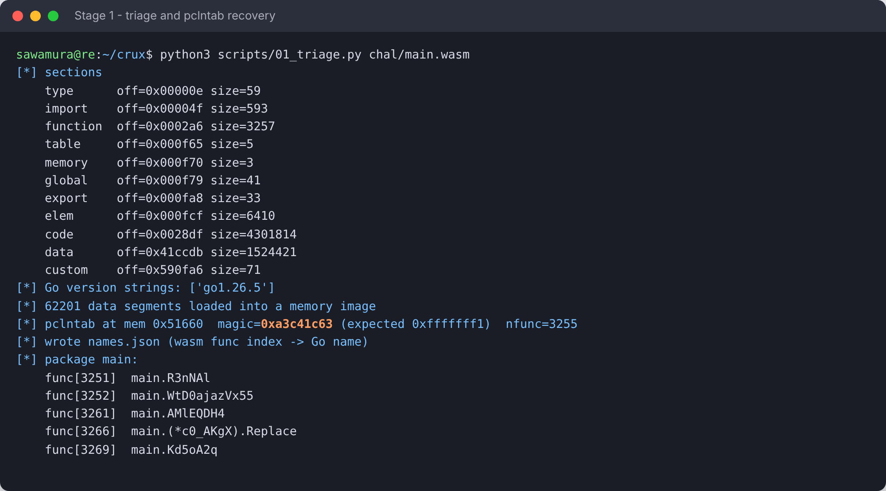
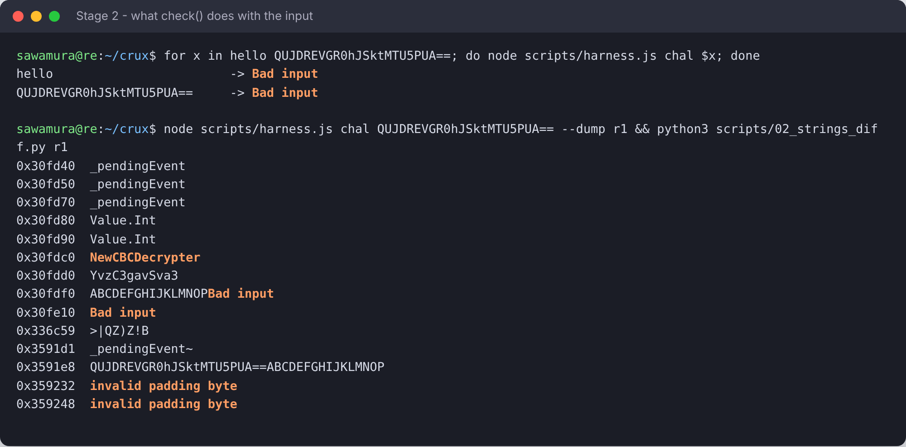
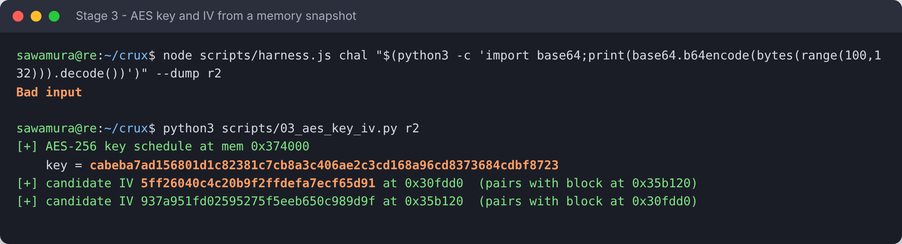
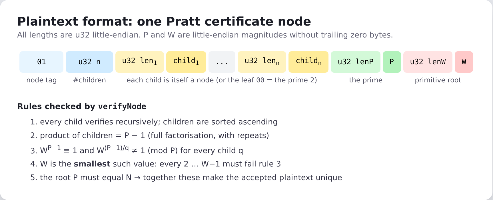
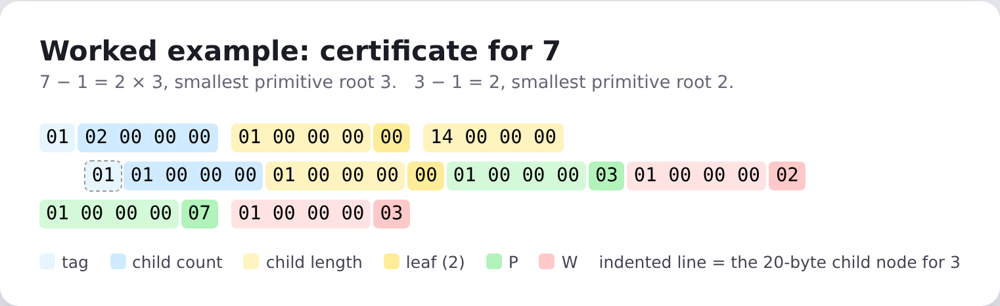
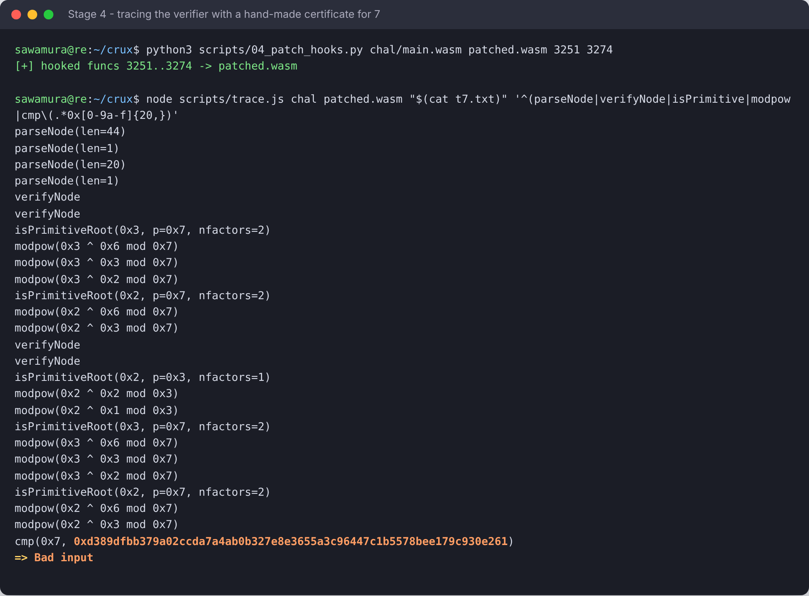
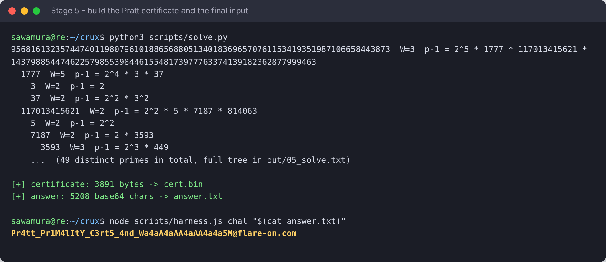

# Flare-On 13 · Challenge 8 · crux

> *"It only asks for one little input string to verify your worth, though our lab notes suggest the underlying code was compiled by someone who genuinely despises humanity."*

| | |
|---|---|
| **Category** | Browser extension · Go → WebAssembly · garble obfuscation · crypto · number theory |
| **Files** | `manifest.json`, `popup.html`, `popup.js`, `styles.css`, `wasm_exec.js`, `main.wasm` (5.8 MB), icons |
| **Flag** | **`Pr4tt_Pr1M4lItY_C3rt5_4nd_Wa4aA4aAA4aAA4a4a5M@flare-on.com`** |



---

## TL;DR

The popup passes one string to `window.check()`, which is implemented in a garble-obfuscated Go program compiled to wasm. The input has to be:

```
base64( AES-256-CBC( key, iv, PKCS7( Pratt-certificate(N) ) ) )
```

* **key** `cabeba7ad156801d1c82381c7cb8a3c406ae2c3cd168a96cd8373684cdbf8723`
* **iv** `5ff26040c4c20b9f2ffdefa7ecf65d91`
* **N** `0xd389dfbb379a02ccda7a4ab0b327e8e3655a3c96447c1b5578bee179c930e261` (a 256-bit prime)

The decrypted plaintext is parsed as a **Pratt primality certificate**, a recursive proof that a number is prime. Its root must be `N`. Children must be the full factorisation of `P-1` in ascending order, and every witness must be the **smallest** primitive root, so exactly one plaintext is accepted. That plaintext is then hashed: **SHA-256(certificate)** is the AES key that decrypts the flag. The flag is therefore unreachable without the exact certificate, so neither patching nor brute force helps.

No brute force was used. Every value was read from the program or derived from the math.



---

## Contents

1. [Recon and triage](#part-1--recon-and-triage)
2. [The input pipeline](#part-2--the-input-pipeline)
3. [Recovering the AES key and IV](#part-3--recovering-the-aes-key-and-iv)
4. [The verifier](#part-4--the-verifier)
5. [Solve](#part-5--solve)
6. [Repository layout and reproduce](#repository-layout)

---

## Part 1 · Recon and triage


### 1.1 The extension is only a shell

`manifest.json` declares a Manifest V3 popup with one notable line:

```json
"content_security_policy": {
  "extension_pages": "script-src 'self' 'wasm-unsafe-eval'; object-src 'self'"
}
```

`wasm-unsafe-eval` is there so the popup can instantiate WebAssembly. `popup.js` contains no logic of its own:

```js
const go = new Go();                                  // from wasm_exec.js (Go's official loader)
fetch('main.wasm')
  .then(r => r.arrayBuffer())
  .then(b => WebAssembly.instantiate(b, go.importObject))
  .then(res => { go.run(res.instance); initializeExtension(); });
...
const res = window.check(input.value);               // the whole challenge
output.innerText = res;
```

So the only interface is **`window.check(string) → string`**, and all the logic is in `main.wasm`.

### 1.2 What kind of wasm is this?

`wasm_exec.js` is Go's loader, so this is a **Go program built with `GOOS=js GOARCH=wasm`**. Three things follow from that:

* The binary contains the whole Go runtime (scheduler, GC, maps, reflection), which is why it is 5.8 MB.
* Go/wasm uses its **own stack** in linear memory (global 0 is `SP`) and passes all arguments and results through that stack. Wasm-level params are almost always just a "resume PC".
* Every Go function is compiled into a **`loop` + `br_table` state machine** so goroutines can be suspended and resumed.

`scripts/01_triage.py` prints the sections and the Go version:



Two observations:

* **Go 1.26.5**, and no wasm `name` section, so the disassembler shows only `func[3270]`-style indices.
* Symbol names such as `main.R3nNAl`, `main.Kd5oA2q` and packages like `LdUZ4Cb` and `S_aSa0z1` are random. This is **[garble](https://github.com/burrowers/garble)**, which renames identifiers and, by default, also changes the pclntab magic so standard Go symbol-recovery tools refuse the binary.

### 1.3 Recovering function names from the pclntab

Go keeps a runtime symbol table, the **pclntab**, so it can print stack traces. Even garbled builds keep it, because the runtime needs it. Since Go 1.20 its header is:

```
u32 magic      (0xfffffff1 normally)
u16 pad = 0, u8 minLC = 1, u8 ptrSize = 8
u64 nfunc, nfiles, textStart, funcnameOffset, cuOffset, filetabOffset, pctabOffset, pclnOffset
```

Here the magic is **`0xa3c41c63`**, so a search for `f1 ff ff ff` finds nothing. The rest of the header is unchanged, so the script searches for the **shape** instead: `00 00 01 08` followed by sane counts and offsets. It finds the table at memory `0x51660`, with `nfunc = 3255`.

To get the table, the script rebuilds the program's initial linear memory by replaying the 62,201 active data segments. It then walks the function table: each entry is `(entryOff, funcOff)`, and the `_func` record's `nameOff` points into the funcname table. The entries are sequential (`entryOff` = `0x1000`, `0x1001`, …), one per compiled wasm function, so the mapping is direct:

```
wasm function index = pclntab index + 20        (the 20 gojs.* imports come first)
```

This writes `out/names.json` (3,255 entries). The `main` package sits at the end of the module, **wasm functions 3251 to 3274**:

| wasm func | name (garbled) | role, worked out in Part 4 |
|---|---|---|
| 3271 | (`main.main`) | registers `check` with `js.Global().Set` |
| 3270 | (closure) | **the `check` function itself**, 39 KB |
| 3267 | | recursive **parser** of the decrypted plaintext |
| 3269 | `main.Kd5oA2q` | recursive **verifier** |
| 3268 | | primitive-root test |
| 3251 / 3252 | `main.R3nNAl` / `main.WtD0ajazVx55` | bigint from int / from bytes |
| 3254, 3256 to 3262 | | bigint cmp, inc, dec, mul, divmod, modpow |
| 3272 | | decodes obfuscated string literals |

Names of the standard library packages are garbled too, but their **method names** survive because they implement interfaces:

| garbled package | evidence | real package |
|---|---|---|
| `S_aSa0z1` | `(*ViyKzO).DecodeString`, `WithPadding` | `encoding/base64` |
| `LdUZ4Cb` | `(*wSlIsLQux).Decrypt`, `BlockSize` | `crypto/aes` |
| `YvzC3gavSva3` | `(*tHAuYBDO1o).CryptBlocks` | `crypto/cipher` (CBC) |
| `a7Zz8kk` | `(*v5gNX4).Write` + a `Sum`-like function | a hash, confirmed as SHA-256 in Part 4 |

### 1.4 Why I did not use Ghidra here

Ghidra needs [nneonneo/ghidra-wasm-plugin](https://github.com/nneonneo/ghidra-wasm-plugin), and plugin builds must match the Ghidra version exactly. Its newest release (v2.4.0) ships a zip only for **Ghidra 12.0**, and my install is **12.1.3**. The options were installing a second Ghidra or building the plugin from source.

That was not worth it here. Ghidra's output for Go/wasm is a single giant `switch` over the resume state, and the stack-based argument passing confuses its type inference. Reading `wasm2wat` output with a small custom lifter (Part 4), together with **dynamic analysis in Node**, turned out to be faster and more reliable.

> If you want Ghidra anyway: install Ghidra 12.0 next to 12.1.3 and use the v2.4.0 plugin zip, then apply `out/names.json` with a small script (`setName` on `func_<index>`).

---

## Part 2 · The input pipeline


### 2.1 Run the challenge outside the browser

`wasm_exec.js` works in Node as well. Pointing `window` at `globalThis` is enough to reproduce `popup.js` exactly (`scripts/harness.js`):

```js
globalThis.window = globalThis;          // popup.js reads window.check
require('./wasm_exec.js');
const go = new Go();
WebAssembly.instantiate(fs.readFileSync('main.wasm'), go.importObject).then(({ instance }) => {
  go.run(instance);                      // Go main() registers check() and parks
  console.log(check(process.argv[2]));
});
```

This gives a scriptable `check()` and, more importantly, direct access to the **whole Go heap** through `instance.exports.mem`. Before and after a call we can save memory to disk with `--dump`.

### 2.2 Every wrong answer looks the same

```text
hello                     -> Bad input
QUJDREVGR0hJSktMTU5PUA==  -> Bad input     (base64 of "ABCDEFGHIJKLMNOP")
```

One error message for everything means the output gives no feedback. The program's **internal state** does, though.

### 2.3 Memory diff around one call

Go builds error values and strings on the heap and never zeroes them immediately. Comparing memory before and after one `check()` call and printing the **new printable runs** (`scripts/02_strings_diff.py`) shows the stages the input went through:



Reading it top to bottom:

| evidence | meaning |
|---|---|
| `QUJDREVGR0hJSktMTU5PUA==ABCDEFGHIJKLMNOP` | the input was **base64-decoded** with the standard alphabet |
| `NewCBCDecrypter`, `YvzC3gavSva3` | a garbled `crypto/cipher` CBC decrypter was built (garble keeps these strings for panics) |
| `invalid padding byte` | after decryption, **PKCS7 unpadding failed** |
| `Bad input` | that error was swallowed and replaced by the generic message |

### 2.4 What this tells us

```
input ──base64──▶ ciphertext ──AES-CBC decrypt──▶ padded plaintext ──unpad──▶ plaintext ──▶ ???
```

* Random inputs will almost never pass the padding check, so testing the real logic requires producing **correctly encrypted** inputs. That needs the key and IV.
* The key is not computed from the input. In the lifted `check` function, a long stretch of byte-building code runs before `LdUZ4Cb.BArYTLDnX`, the garbled `aes.NewCipher`, is called. Part 3 confirms that the resulting key is identical for every input.

Reading those constants by hand through the state machine is tedious. Part 3 reads the key straight out of memory instead.

---

## Part 3 · Recovering the AES key and IV


The idea: there is no need to follow how the program builds the key. Once `aes.NewCipher` has run, the key's **expanded schedule** sits in memory, and that schedule has a mathematical structure that can be searched for.

### 3.1 Key: search memory for an AES key schedule

AES key expansion produces words `w[0..]`. The first `Nk` words are the raw key (`Nk = 4/6/8` for AES-128/192/256), and the next word is fixed by the previous ones:

```
w[Nk] = w[0] XOR SubWord(RotWord(w[Nk-1])) XOR Rcon[1]          (Rcon[1] = 0x01000000)
```

Random data satisfies this by chance with probability 2⁻³². `scripts/03_aes_key_iv.py` slides over the memory dump 4 bytes at a time, tests the relation for `Nk = 4, 6, 8`, and stops at the first hit. Go stores the schedule as little-endian `uint32`s, so each word is repacked big-endian to print the key.

### 3.2 IV: pair up CBC blocks

For a ciphertext we chose, `C = bytes(range(100, 132))`, CBC decryption of the first block is:

```
P0 = AES_decrypt(key, C0) XOR IV  =  D XOR IV
```

`D` can be computed now that the key is known. After the call, **both `P0` and `IV` are somewhere in the changed memory**. So the script collects every 16-byte window in the changed regions and looks for a pair `X`, `D XOR X` that are both present. Exactly one pair turns up. Its two halves are the IV and `P0`, and the IV is the one that is not input-dependent.



### 3.3 Confirm both candidates

| | value |
|---|---|
| cipher | **AES-256-CBC**, PKCS7 padding |
| key | `cabeba7ad156801d1c82381c7cb8a3c406ae2c3cd168a96cd8373684cdbf8723` |
| IV | `5ff26040c4c20b9f2ffdefa7ecf65d91` |

Checks:

1. The same key schedule appears for different inputs, so the key is a constant of the program.
2. Encrypting `b"hello world test"` with this key and IV and passing it to `check()` makes the plaintext `hello world test` appear in the Go heap, and the `invalid padding byte` error **disappears**. The second candidate (`937a95…`, which is just `P0`) fails this test.
3. The result is still `Bad input`, which means a **second, real check** runs on the plaintext. That check is Part 4.

```python
from Crypto.Cipher import AES
from Crypto.Util.Padding import pad
import base64
def enc(pt: bytes) -> str:
    return base64.b64encode(AES.new(KEY, AES.MODE_CBC, IV).encrypt(pad(pt, 16))).decode()
```

From here on, plaintexts can be chosen freely.

---

## Part 4 · The verifier


With the key and IV known, any plaintext can be fed in. Now the remaining logic has to be understood: `check` → parser (3267) → `main.Kd5oA2q` and the bigint cluster.

### 4.1 Making Go/wasm readable

`wasm2wat` gives raw stack code. Every Go function has this shape:

```wat
(func (;3269;) (param i32) (result i32)
  loop
    block … block            ;; ~70 nested blocks
      local.get 0
      br_table 0 0 1 1 2 …   ;; resume state -> basic block
    end
    … basic block 0 …        ;; sets local 0 = next state, br back to loop
```

`scripts/lift.py` is a ~60-line symbolic stack evaluator. It turns each instruction run into statements, names calls from `names.json`, and renders state changes as `goto state_N`. It is not a decompiler, but it is enough. All `main.*` functions lifted this way are in `out/lifted/`. An excerpt from `Kd5oA2q`:

```text
L2 = [[SP+216]+16]32_u              ; itab/type hash of the node interface
if !((L2 == 0x83c733b)):            ; -> internal node type
goto state_9
...
if !((L2 == 0xb49d0978)):           ; -> leaf type
...
CALL main.Kd5oA2q                   ; recurse into each child
if !([SP+0x10]8_u):  goto fail
...
CALL f3254                          ; compare(child, previous child)
if ([SP+0x10] < 0):  goto fail      ; children must be non-decreasing
CALL f3258                          ; product *= child
...
CALL f3268                          ; is W a primitive root?
```

The two type hashes show that a node is a **Go interface with two implementations**: an inner node and a leaf. The verifier is a type switch.

### 4.2 A hand-rolled bigint library

The obfuscated `main.*` helpers are a small arbitrary-precision integer type, `{neg bool; mag []byte}` with **little-endian** magnitude bytes. This was identified from the lifted bodies (for example, 3254 compares lengths first, then bytes from the most significant end) and confirmed at runtime:

| func | role | how it was confirmed |
|---|---|---|
| 3251 `R3nNAl` | `fromInt(int64)` | loop of `x & 0xff; x >>= 8` |
| 3252 `WtD0ajazVx55` | `fromBytes([]byte)` | copies bytes, trims trailing zeros |
| 3254 | `cmp(a, b) → -1/0/1` | sign, then length, then bytes from the top |
| 3256 / 3257 | `inc` / `dec` | traced `inc(0x3)`, `dec(0x7)` |
| 3258 | `mul` | traced `mul(0x3, 0x3)` = 9 |
| 3261 `AMlEQDH4` | `divmod` | traced `divmod(0x9, 0x7)` |
| 3262 | `modpow(b, e, m)` | traced `0x3 ^ 0x6 mod 0x7` |

### 4.3 The plaintext format (parser 3267)

The parser reads the first byte as a tag:

* **`00`**: a **leaf**. The verifier treats it as the value **2**.
* **`01`**: an **inner node**. It reads `u32 n`, then `n` times `u32 len` followed by a child of that length (parsed recursively), then `u32 lenP | P`, then `u32 lenW | W`.

Lengths are bounds-checked and the node must consume its bytes exactly.



### 4.4 Watching it run: entry hooks without a debugger

To confirm the rules, I traced real calls. Node has no wasm debugger that understands Go's stack, so I patched the module (`scripts/04_patch_hooks.py`). Every function from 3251 to 3274 gets a small prologue:

```wat
local.get 0  i32.eqz  if            ;; only on a fresh call (resume PC = 0)
  i32.const 0x70000000 + <func index>
  call 5                            ;; existing import gojs.runtime.nanotime1
end
```

`nanotime1` normally receives Go's `SP`, which can never be `≥ 0x70000000`. The replacement JS import in `scripts/trace.js` recognises the marker, reads the arguments from the **Go stack** (`[SP+8]`, `[SP+16]`, …) and decodes bigint arguments. No new imports or types are added, and the patched module passes `wasm-validate`.

Then I built the smallest interesting certificate by hand, for the prime **7**:



And traced it:



What the trace shows:

* `parseNode(len=44)` → leaf, then the 20-byte child (3) → leaf: the recursive layout is right.
* `isPrimitiveRoot(0x3, p=0x7)` tests `3^6`, `3^3`, `3^2 mod 7`, that is `W^(P-1)` and `W^((P-1)/q)` for each distinct prime factor `q ∈ {2, 3}`.
* Then **`isPrimitiveRoot(0x2, p=0x7)`**: the verifier checks every candidate **below** `W` and requires each to fail. `2^3 ≡ 1 (mod 7)` fails, so 3 really is the *smallest* primitive root. This rule is what makes the certificate unique.
* Finally, **`cmp(0x7, 0xd389dfbb…e261)`**: the root prime is compared with a constant. The certificate itself was valid, but 7 is not that constant, so the result is still `Bad input`.

### 4.5 The target and the flag key

The constant from the last comparison is:

```
N = 0xd389dfbb379a02ccda7a4ab0b327e8e3655a3c96447c1b5578bee179c930e261
  = 95681613235744740119807961018865688051340183696570761153419351987106658443873
```

`sympy.isprime(N)` returns `True`, and the value is 256 bits. So the goal is a **valid Pratt certificate whose root is N**.

What happens after the comparison: after the successful run in Part 5, a key-schedule scan of memory (the same technique as Part 3) finds a **second AES-256 key**, `c9c3e339…1e358086`. That is exactly **`SHA-256(cert.bin)`**, the hash of the certificate plaintext. The garbled package `a7Zz8kk` is SHA-256, and the flag is stored encrypted under that key.

The consequences:

* Patching the final comparison does not help, because the flag key comes from the certificate bytes.
* That is why the format is strict: sorted children, full factorisation, smallest witness. With these rules, **exactly one byte string** hashes to the right key.

Rebuilt in Go, the verifier is roughly:

```go
func verify(n Node) bool {                      // main.Kd5oA2q
    leaf, ok := n.(*Leaf); if ok { return true } // leaf == 2
    nd := n.(*Inner)
    prod, prev := big(1), big(0)
    for _, c := range nd.children {
        if !verify(c) { return false }
        v := value(c)                           // 2 for a leaf, c.P otherwise
        if cmp(v, prev) < 0 { return false }    // ascending
        prod = mul(prod, v); prev = v
    }
    if cmp(prod, dec(nd.P)) != 0 { return false }        // product == P-1
    if !isPrimitiveRoot(nd.W, nd.P, nd.children) { return false }
    for c := big(2); cmp(c, nd.W) < 0; c = inc(c) {      // W must be the smallest
        if isPrimitiveRoot(c, nd.P, nd.children) { return false }
    }
    return true
}
```

*(Reconstruction from the lifted code and traces. The real code uses garbled names and its own bigint type.)*

---

## Part 5 · Solve


### 5.1 Pratt certificates in one paragraph

**Lucas' theorem:** if some `a` satisfies `a^(p-1) ≡ 1 (mod p)` and `a^((p-1)/q) ≢ 1 (mod p)` for every prime `q` dividing `p-1`, then `a` has order exactly `p-1`. The multiplicative group mod `p` therefore has `p-1` elements, so `p` is prime.

The proof needs the prime factors of `p-1` to be primes themselves, so each of them gets its own proof, recursively, down to 2. That tree is a **Pratt certificate** (Vaughan Pratt, 1975). It is short, polynomial in the bit length, and quick to check. That is exactly what `crux` asks for: *"verify your worth"* means *prove N is prime*.

The program makes the tree **canonical**:

* children = the full factorisation of `P-1` with multiplicity, sorted ascending
* `W` = the smallest primitive root of `P`

Building the certificate only needs two things: factoring each `P-1`, and finding the smallest primitive root. Nothing is guessed.

### 5.2 Is factoring N−1 feasible?

The challenge would be impossible if `N-1` had two large prime factors. It does not:

```
N - 1 = 2^5 × 1777 × 117013415621 × 14379885447462257985539844615548173977763374139182362877999463 (204-bit prime)
```

The 204-bit factor's own `q-1` again splits into small and medium primes, and so on. sympy's `factorint` finishes the **whole tree** (49 distinct primes, nested up to 8 levels deep) in about 3 seconds. The prime was clearly chosen so that the tree can be built.

### 5.3 The solver

`scripts/solve.py`:

```python
def cert(p):
    if p == 2:
        return b'\x00'                                   # leaf
    f  = factorint(p - 1)                                # {q: e}
    qs = sorted(f)
    w  = 2
    while not all(pow(w, (p - 1) // q, p) != 1 for q in qs):
        w += 1                                           # smallest primitive root
    children = [cert(q) for q in qs for _ in range(f[q])]   # sorted, with repeats
    return serialize(p, w, children)

c   = cert(N)                                            # 3891 bytes
ans = base64.b64encode(AES.new(KEY, AES.MODE_CBC, IV).encrypt(pad(c, 16)))
```

`serialize` writes exactly the format from Part 4: `01 | u32 n | (u32 len | child)* | u32 lenP | P | u32 lenW | W`, with little-endian, minimal-length integers. (`W^(P-1) ≡ 1` is not tested in the loop because it always holds for prime `P`, by Fermat.)



The top of the tree:

```
N = 9568…3873                          W=3   N-1 = 2^5 · 1777 · 117013415621 · 1437…9463
├─ 1777                                W=5   2^4 · 3 · 37
├─ 117013415621                        W=2   2^2 · 5 · 7187 · 814063
│   └─ 7187 → 3593 → 449 → 7 → 3 …
└─ 14379885447462257985539844615548173977763374139182362877999463
                                       W=3   (204-bit, splits further)
```

The full tree is in [`out/certificate_tree.txt`](out/certificate_tree.txt).

### 5.4 Result

Running `check()` on the original, unmodified `main.wasm`:

```
$ node scripts/harness.js chal "$(cat out/answer.txt)"
Pr4tt_Pr1M4lItY_C3rt5_4nd_Wa4aA4aAA4aAA4a4a5M@flare-on.com
```

The same input in the real extension popup:


## 🏁 Flag

```
Pr4tt_Pr1M4lItY_C3rt5_4nd_Wa4aA4aAA4aAA4a4a5M@flare-on.com
```

### 5.5 Takeaways

* **Go/wasm + garble** removes names but not the runtime metadata. The pclntab survives with only its magic changed, so search for the header **shape**, not the magic.
* **Dynamic analysis beats static analysis** for state-machine code. Running the wasm in Node gives full heap access, and diffing memory around one call shows the pipeline in minutes.
* **Crypto keys leave fingerprints.** An AES key schedule can be found by its key-expansion relation, and a CBC IV by XOR-pairing blocks of a chosen ciphertext.
* **Tracing without a debugger:** routing an entry hook through an existing import (`nanotime1`) with an impossible marker value adds no imports and keeps the module valid.
* **Do the math instead of patching.** The flag key is `SHA-256(certificate)`, so the only way in is to build the one correct certificate. Recognising "factorisation tree + primitive roots" as a Pratt certificate turns the rest into a short script.

---

## Repository layout

```
8-crux/
├── README.md              this writeup
├── images/                screenshots and figures used in the writeup
├── scripts/
│   ├── 01_triage.py       sections + pclntab name recovery
│   ├── harness.js         run check() in Node, optional memory dumps
│   ├── 02_strings_diff.py strings created during one check() call
│   ├── 03_aes_key_iv.py   key schedule scan + IV recovery
│   ├── 04_patch_hooks.py  inject entry hooks into wasm functions
│   ├── trace.js           print hooked calls with decoded bigints
│   ├── lift.py            tiny Go/wasm stack-to-statement lifter
│   └── solve.py           build the certificate and the final input
└── out/
    ├── names.json         wasm function index → recovered Go name
    ├── lifted/            lifted pseudo-code of the main.* functions
    ├── certificate_tree.txt   full factor tree of N
    ├── cert.bin           the 3891-byte certificate (plaintext)
    └── answer.txt         the 5208-character input
```

## Reproduce

```bash
pip install pycryptodome sympy
python3 scripts/solve.py                       # -> cert.bin, answer.txt
node scripts/harness.js <challenge-dir> "$(cat answer.txt)"
# Pr4tt_Pr1M4lItY_C3rt5_4nd_Wa4aA4aAA4aAA4a4a5M@flare-on.com
```

Or load the extension unpacked (`chrome://extensions` → Developer mode → *Load unpacked*), paste `out/answer.txt` into the box and press **Check**.

**Tools used:** Python 3 (sympy, pycryptodome), Node.js 22, WABT 1.0.36 (`wasm2wat`, `wasm-validate`), Playwright/Chromium for the screenshots.
