# Flare-On 13 (2026) - Challenge 9: NeonOutRun

> *"Congratulations on surviving to the final phase of the experiment, where we've wired your central nervous system directly into a 28-lap synthwave racing simulator. You are welcome to drive to the finish line like an obedient little test monkey, though we both know the freedom promised at the end of the highway is a cruel statistical mirage. Rip apart the engine and bend the simulation's physics to your will, or spend the rest of your natural life doing laps in our neon hamster wheel."*

| | |
|---|---|
| **File** | `neon_outrun` (ELF64 x86-64 PIE, stripped, 21,183,560 bytes) |
| **SHA-256** | `73edf4e289d199f5e5df622855c1787ba12a4a0c7205813103d7a53f300220e0` |
| **Stack** | Rust, Tauri 2 (WebKitGTK frontend), embedded V8 (`rusty_v8`) |
| **Tools** | Ghidra, Python (`brotli`, `zstandard`, `unicorn`), Chrome for rendering the frontend |
| **Flag** | `R3_ag3nt_4b0ut_t0_f33l_d1zzy@flare-on.com` |

> **Addresses.** All addresses are Ghidra's (image base `0x100000`). `objdump` and file offsets are `0x100000` lower, which is why `solve.py` uses `0x67eb83` for Ghidra's `FUN_0077eb83`.

---

## TL;DR

The window is only a renderer. Every frame it calls the Tauri command `plugin:neon|e`, and the Rust backend runs a hidden JavaScript game inside an embedded V8 engine.

1. **The game script is hidden.** It is a 1,942-byte blob that is XORed with `d3 5a`, wrapped in a flag-byte container, then zstd, then raw deflate. Unpacked, it is 4,229 bytes of plain JS.
2. **The script's flag is a decoy.** Finishing 28 laps in the plain script produces `decode_this_system_to_win_it@f1are-on.com` (note the digit `1`).
3. **The host patches three JS built-ins with native Rust functions** before it runs the script: `Array.prototype.sort`, `Math.min` and `String.prototype.replaceAll`. Together they turn the 28 lap times into the flag.
4. **The check.** Each lap adds `c_i * sin(pi/180 * (k_i ± t_i))` to an accumulator. The finish compares it with `sum(c_i)`. Every `c_i` is negative, so this only holds if every sine is exactly 1. That gives one whole-number lap time per lap, and each one is an ASCII character of the flag.

No racing and no brute force: each lap time comes from one modular equation.

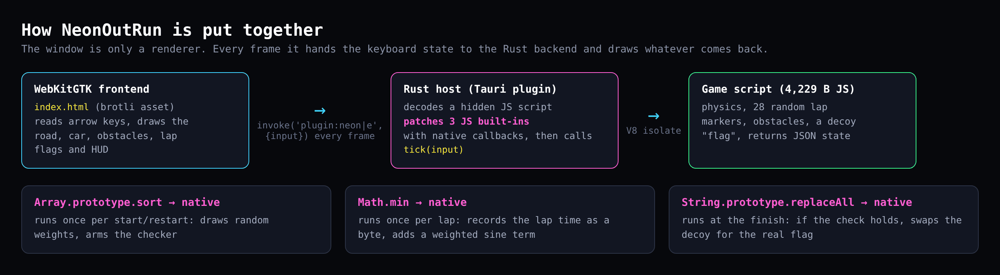

---

## 1. Triage

The game runs as advertised: arrow keys, a straight road, obstacles and 28 lap markers (the blue arrows).

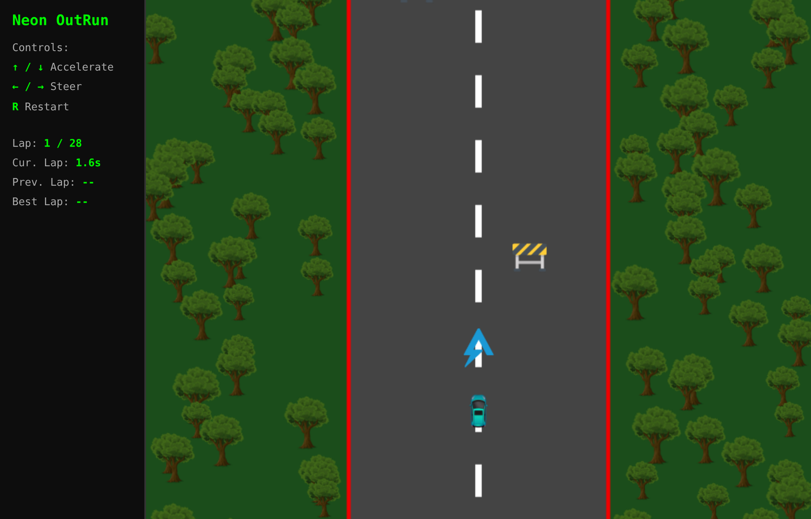

*The real `index.html` from the binary, rendered in Chrome with the decoded game script standing in for the Rust backend (see §4).*

The binary itself:

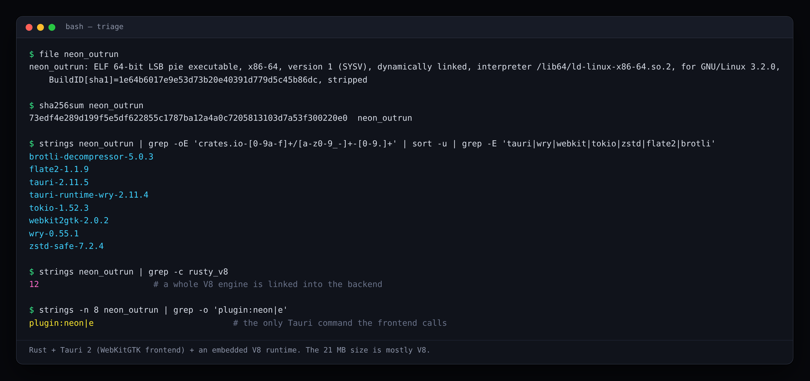

Three things stand out:

- It is a **Tauri 2** app. The UI is HTML in WebKitGTK and the logic sits in a Rust backend.
- **`rusty_v8`** is linked in. A whole JavaScript engine in the backend means the backend itself runs JS.
- The frontend only ever calls one command: **`plugin:neon|e`**.

---

## 2. The frontend

Tauri stores frontend files in a table in `.data.rel.ro`. Each record is 32 bytes: name pointer, name length, data pointer, data length. The data is brotli-compressed. The pointers are filled in by `R_X86_64_RELATIVE` relocations, so read them from `.rela.dyn`, not from the raw bytes.

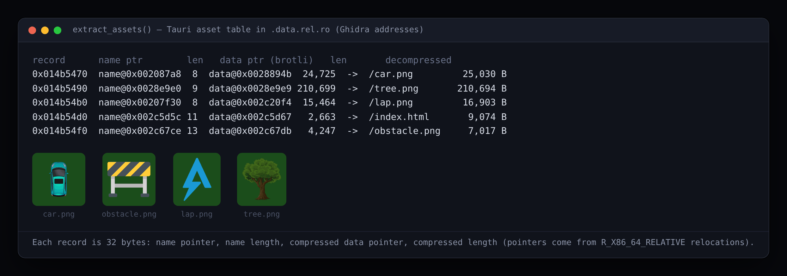

`index.html` turned out to contain no game logic. Its loop is just:

```js
input.bounds = {left: roadLeft, right: roadRight};
let resStr = await invoke('plugin:neon|e', {input: JSON.stringify(input)});
let res = JSON.parse(resStr);          // {state, obstacles, laps, totalLaps}
// ...draw road, trees, lap markers, obstacles, car, HUD
if (state.finished) document.getElementById('neon').innerText = state.neon;
```

So whatever produces `state.neon` lives in the backend.

---

## 3. Finding the hidden script

A V8 runtime needs source text, but there is no game code anywhere in `strings`. An entropy scan of `.rodata` shows compressed regions, and the zstd decoder is the way in. Following the callers of zstd's frame-magic check (`cmp eax, 0xFD2FB528`) leads up to **`FUN_00788c64`**, the worker thread that creates the V8 isolate.

Just before it decompresses, that function XORs a blob:

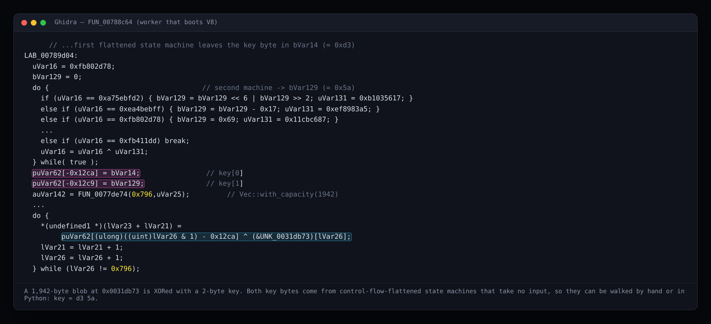

Both key bytes come from **control-flow-flattened state machines**. Each one is a `while(true)` loop over `if (state == X) { op; next = Y }`, ending with `state ^= next`. They take no input, so they always produce the same value. Walking them in Python (`flattened_byte()` in `solve.py`) gives the key **`d3 5a`**.

The XORed data then goes through three more layers, all inside the same function:

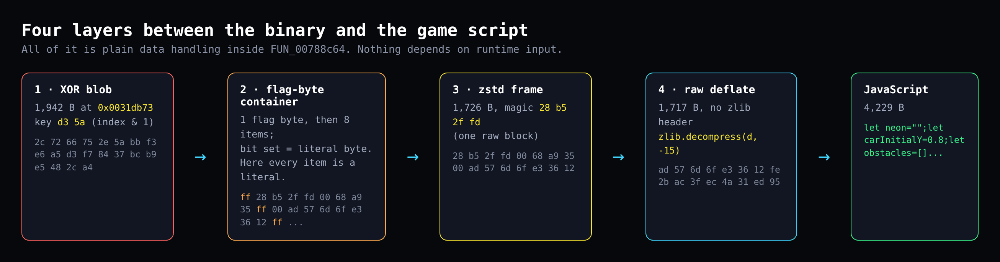

| Layer | Size | How to undo it |
|---|---|---|
| XOR blob at `0x0031db73` | 1,942 B | `b[i] ^ key[i & 1]` |
| flag-byte container | 1,942 B | flag byte, then 8 items; bit set = copy one literal byte |
| zstd frame (`28 b5 2f fd`) | 1,726 B | `zstandard` (it holds one raw block) |
| raw deflate | 1,717 B | `zlib.decompress(d, -15)` |
| **JavaScript** | **4,229 B** | |

---

## 4. The game script, and its decoy

Pretty-printed, the script is about 180 lines: physics, collision, random lap positions and random obstacles. The interesting parts:

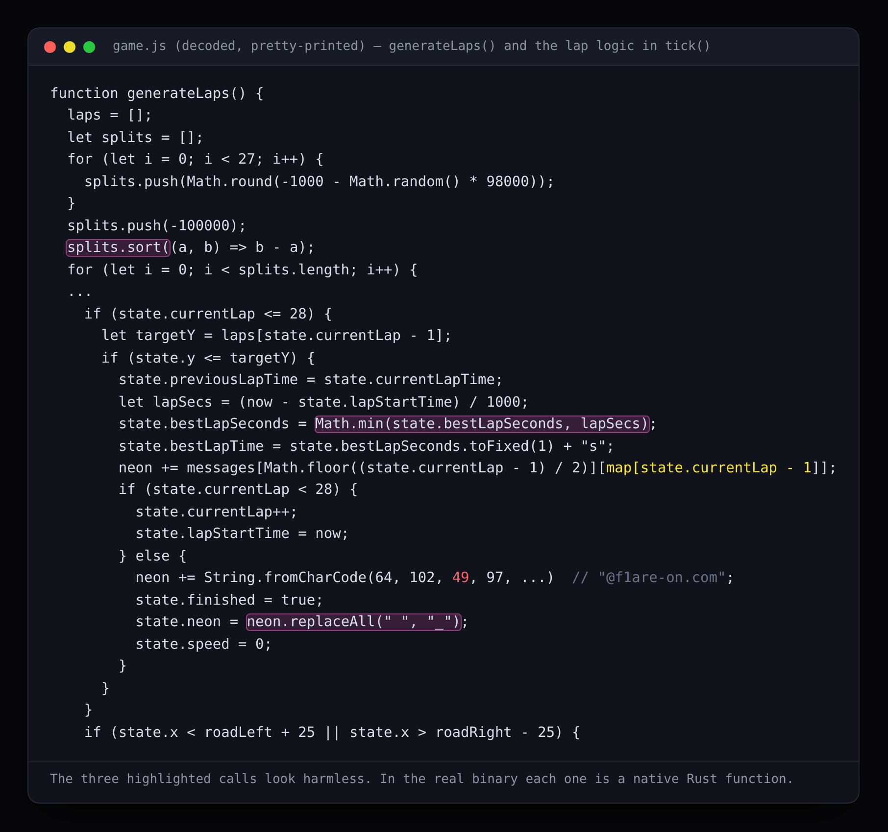

On each lap crossing it appends one character from a list of 14 villain monologue lines:

```js
neon += messages[Math.floor((state.currentLap - 1) / 2)][map[state.currentLap - 1]];
```

`map` is a fixed 28-entry table, so the result does not depend on how you drive. After lap 28 it appends `String.fromCharCode(64, 102, 49, 97, ...)` and replaces spaces with underscores.

To see the result without driving 28 laps, I rendered `index.html` in Chrome with a two-line shim: `window.__TAURI__.core.invoke` calls the decoded `tick()` directly. I then moved every lap marker behind the car, so the game's own code counts one lap per frame:

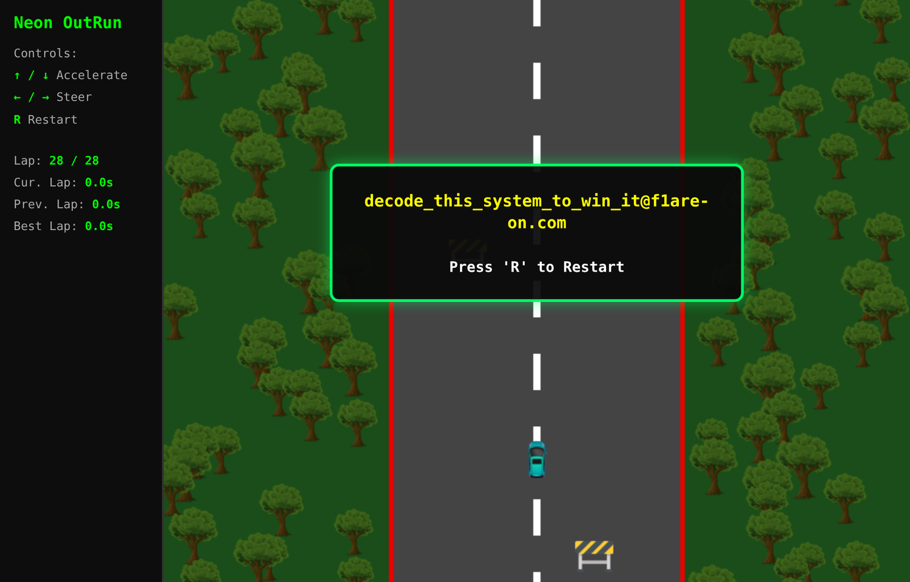

```
decode_this_system_to_win_it@f1are-on.com
```

That `f1are` (digit one, char code `49`) is the giveaway: this is not the flag. It also hints at the route ("decode this system"). Something in the native host must rewrite this string.

---

## 5. The host patches JavaScript

Back in `FUN_00788c64`, before the script is compiled, the function looks up a series of properties on the V8 global object. Each property name is stored as **two equal-length constants that are XORed together**, so no name appears in `strings`:

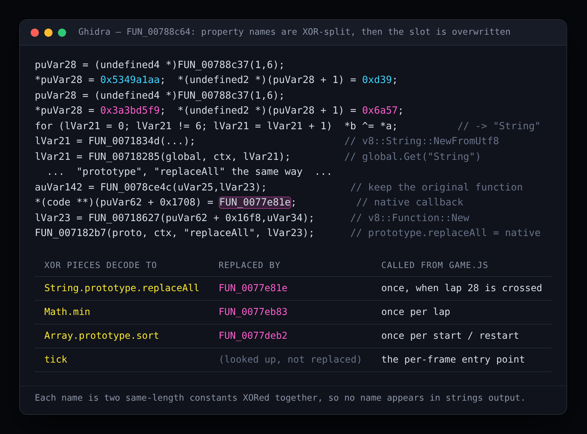

Each name is decoded the same way (6 bytes `aa a1 49 53 39 0d` XOR `f9 d5 3b 3a 57 6a` = `String`). The function walks `String → prototype → replaceAll`, wraps a native Rust function in a `v8::Function`, and writes it back over the original. Decoding all nine names gives the full picture:

| Hooked built-in | Native replacement | When game.js calls it |
|---|---|---|
| `Array.prototype.sort` | `FUN_0077deb2` | once per start or restart (`splits.sort(...)`) |
| `Math.min` | `FUN_0077eb83` | once per lap (`Math.min(bestLapSeconds, lapSecs)`) |
| `String.prototype.replaceAll` | `FUN_0077e81e` | once, at the finish (`neon.replaceAll(" ", "_")`) |

(`tick` is the ninth name: it is looked up so the host can call it every frame.)

Each replacement **calls the original built-in first and returns its result**, so the game still behaves normally. Only the Rust side does anything extra.

---

## 6. What the three hooks compute

Cleaned up from Ghidra, the three hooks share four globals:

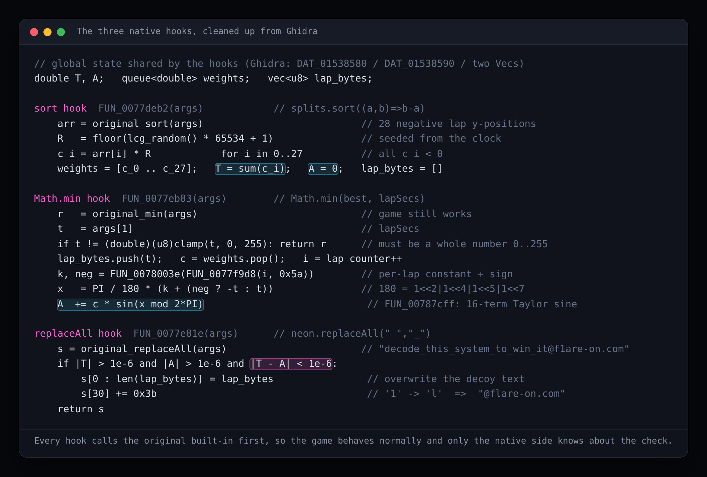

### `sort` hook: `FUN_0077deb2` (arms the check)

`splits` holds the 28 lap y-positions, all negative (between -1,000 and -100,000). The hook draws one random integer `R` in 1..65534 from an LCG (`* 0x5851f42d4c957f2d + 0x14057b7ef767814f`) seeded with the clock, and builds:

- `c_i = splits[i] * R`: 28 weights, **all negative**, pushed into a queue,
- `T = sum(c_i)`, stored at `DAT_01538580`,
- `A = 0`, stored at `DAT_01538590`, and the lap-byte vector cleared.

### `Math.min` hook: `FUN_0077eb83` (one term per lap)

`args[1]` is `lapSecs`. If it is **not a whole number from 0 to 255**, the hook returns immediately. Otherwise it:

1. pushes `lapSecs` as a byte onto the lap-byte vector,
2. pops `c_i` and increments the lap index `i`,
3. gets a per-lap 64-bit constant `k_i` and a sign bit from `FUN_0078003e(FUN_0077f9d8(i, 0x5a))` (`0x5a` is the output of another input-free state machine),
4. adds a sine term to `A`:

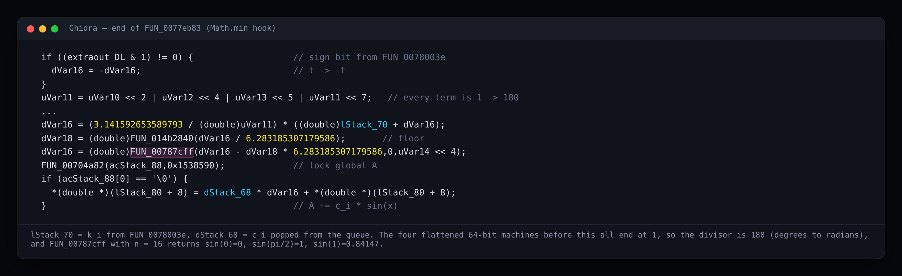

Two details hide in the obfuscation:

- The four flattened 64-bit state machines in front of this block all end with the value **1**, so the divisor `1<<2 | 1<<4 | 1<<5 | 1<<7` is **180**. The angle is in **degrees**: `x_i = π/180 · (k_i ± t_i)`.
- `FUN_00787cff(x, 0, 16)` is a recursive 16-term series. Evaluating it in Unicorn gives `f(0) = 0`, `f(π/2) = 1`, `f(1) = 0.8414709848`, so it is **`sin`**.

`FUN_0077f9d8` and `FUN_0078003e` are both large flattened functions, but they only depend on the lap index. I did not read them line by line: I ran them in Unicorn for `i = 0..27` and recorded `k_i` and the sign.

### `replaceAll` hook: `FUN_0077e81e` (the finish)

It calls the real `replaceAll` (giving the decoy), then checks:

```
|T| > 1e-6  and  |A| > 1e-6  and  |T - A| < 1e-6
```

If that holds, it copies the lap-byte vector over the start of the string and adds `0x3b` to byte 30, turning the `1` in `@f1are` into `l`. The decoy's 28 characters are replaced by the 28 lap times, and the domain becomes `@flare-on.com`.

---

## 7. Solving it

The finish condition is:

$$\sum_{i=0}^{27} c_i \sin(x_i) = \sum_{i=0}^{27} c_i, \qquad c_i < 0$$

Because `sin(x) ≤ 1` and `c_i < 0`, every term satisfies `c_i·sin(x_i) ≥ c_i`. The two sums can only be equal if **every** `sin(x_i) = 1`. This is the "statistical mirage" in the prompt: the weights are random on every run, but the sign argument makes them irrelevant.

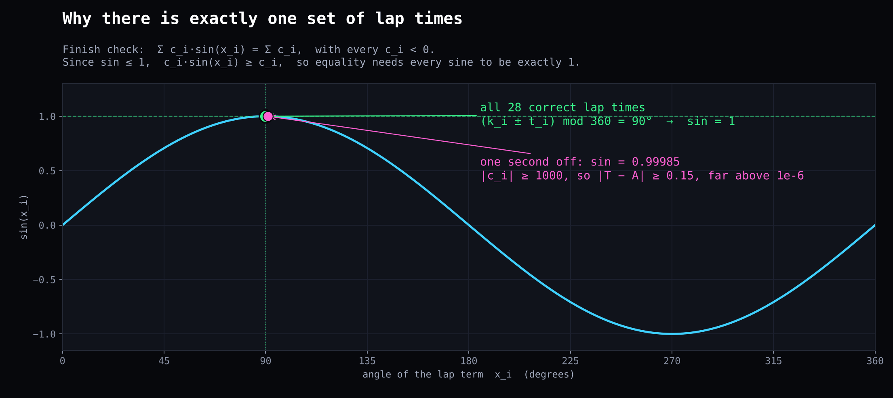

The tolerance is tight as well. Being one second off on one lap gives `sin(91°) = 0.99985`, and with `|c_i| ≥ 1000` that already moves `A` by at least 0.15, far above `1e-6`.

So for each lap:

$$(k_i \pm t_i) \equiv 90 \pmod{360} \;\Longrightarrow\; t_i = \pm(90 - k_i) \bmod 360$$

For example, lap 0 has `k_0 = 168236812` and the sign bit set, so `t_0 = -(90 - 168236812) mod 360 = 82 = 'R'`. Every lap gives exactly one value in 0..255, and all 28 are printable:

| Lap | t (s) | | Lap | t (s) | | Lap | t (s) | | Lap | t (s) | |
|---|---|---|---|---|---|---|---|---|---|---|---|
| 1 | 82 | `R` | 8 | 116 | `t` | 15 | 95 | `_` | 22 | 108 | `l` |
| 2 | 51 | `3` | 9 | 95 | `_` | 16 | 116 | `t` | 23 | 95 | `_` |
| 3 | 95 | `_` | 10 | 52 | `4` | 17 | 48 | `0` | 24 | 100 | `d` |
| 4 | 97 | `a` | 11 | 98 | `b` | 18 | 95 | `_` | 25 | 49 | `1` |
| 5 | 103 | `g` | 12 | 48 | `0` | 19 | 102 | `f` | 26 | 122 | `z` |
| 6 | 51 | `3` | 13 | 117 | `u` | 20 | 51 | `3` | 27 | 122 | `z` |
| 7 | 110 | `n` | 14 | 116 | `t` | 21 | 51 | `3` | 28 | 121 | `y` |

```
R3_ag3nt_4b0ut_t0_f33l_d1zzy@flare-on.com
```

Doing this in the game would mean crossing each lap marker at exactly `t_i.000` seconds (the time is measured in milliseconds) for 2,506 seconds in total, about 42 minutes of driving with no mistakes.

---

## 8. Solver

`solve.py` reproduces everything from the binary alone:

1. extract the Tauri assets (brotli),
2. unpack the game script (XOR key from the state machines, container, zstd, deflate),
3. decode the nine hooked property names,
4. run `FUN_0077f9d8` and `FUN_0078003e` in Unicorn for each lap,
5. solve the 28 congruences.

```
pip install unicorn brotli zstandard
python solve.py neon_outrun
```

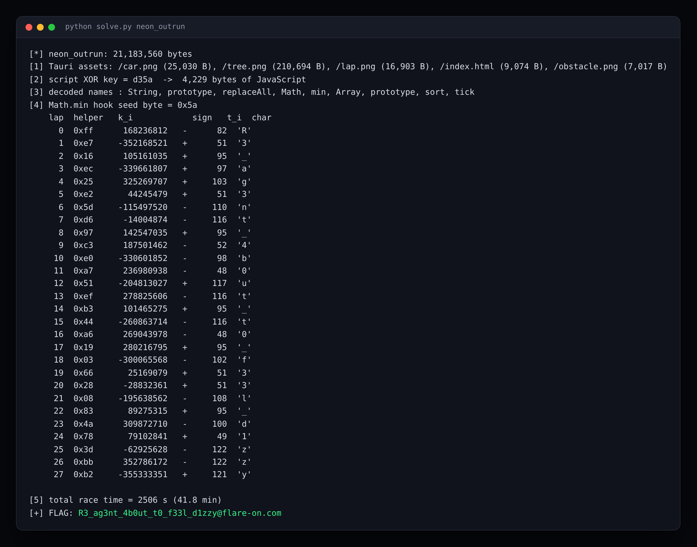

---

## Wrong turns

- **Searching `strings` for game code.** There is none. The JS exists only after four decoding layers at runtime.
- **Treating the decoy as the answer.** `decode_this_system_to_win_it@f1are-on.com` looks like a flag. The digit `1` in `f1are` is the tell, and the hook that turns it into `l` confirms it.
- **Expecting the check to depend on the random weights.** I first assumed the 28 bytes had to satisfy some checksum tied to `T`, which would have needed `R`. The signs make `R` irrelevant: with all `c_i < 0`, the only way to hit `T` is `sin = 1` everywhere.
- **Reading the flattened helpers by hand.** `FUN_0077f9d8` and `FUN_0078003e` are long chains of flattened state. They are pure functions of the lap index, so running them was faster and less error-prone than lifting them.

---

## Takeaways

- **An embedded script engine means two programs.** When a native binary links V8, the host can rewrite the script's world. Here the JS was honest and the host changed what `Math.min` meant.
- **Look for monkey-patched built-ins.** `Global.Get` → `Function::New` → `Object::Set` on a built-in name is the pattern. The XOR-split names hid them from `strings`, not from the call sequence.
- **Flattened code with no inputs is a constant.** Every state machine here that took no arguments (the XOR key, the `0x5a` seed, the four "1"s) could be walked once and replaced by its result.
- **Look at the signs before the numbers.** A random-looking equality turned into "every sine is 1" once it was clear that all weights were negative.
